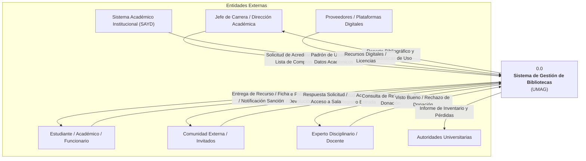
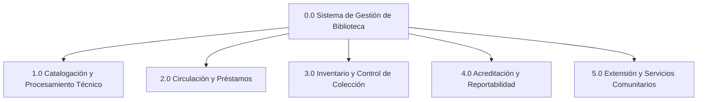

# Estructuración de Procesos del Sistema de Biblioteca para Modelado DSIA
**Documento de Levantamiento y Especificación de Procesos**  
**Asignatura:** Diseño de Sistemas de Información Administrativos (DSIA I)  
**Institución:** Universidad de Magallanes (UMAG) — Biblioteca Central  
**Origen:** Sistematización y ordenamiento de información a partir de `Plantilla preguntas servicios.md` y entrevistas previas.

---

## 1. Visión General del Sistema (Nivel 0 / Diagrama de Contexto)

El **Sistema de Gestión de Biblioteca (SGB)** tiene como objetivo coordinar, almacenar, controlar y proveer acceso a los recursos bibliográficos (físicos y digitales) y equipamiento de apoyo académico de la Universidad, interactuando con la comunidad universitaria, autoridades, unidades académicas y el medio externo.

---

## 2. Catálogo de Entidades Externas y Almacenes de Datos

### 2.1. Entidades Externas (Actores de Frontera)
| Identificador | Entidad Externa | Rol / Descripción |
| :--- | :--- | :--- |
| **EE-01** | **Jefe de Carrera / Dir. Académica** | Solicita reportes de acreditación por carrera y envía listas de títulos a adquirir. |
| **EE-02** | **Usuario Comunidad Universitaria** | Estudiantes, docentes y funcionarios que solicitan préstamos de libros, salas, equipos y donan material. |
| **EE-03** | **Usuario Externo / Invitado** | Personas de la comunidad general que acceden a sala, participan en talleres o solicitan actividades. |
| **EE-04** | **Experto Disciplinario / Docente** | Valida la pertinencia y relevancia académica de los libros recibidos por donación. |
| **EE-05** | **Autoridades Universitarias** | Reciben el balance final del inventario anual y la nómina oficial de libros dados de baja / extraviados. |
| **EE-06** | **Sistema SAYD (Externo)** | Sistema central institucional que provee la nómina anual de estudiantes y funcionarios para validar matrículas y roles. |
| **EE-07** | **Proveedores / Plataformas Externas** | Plataformas comerciales suscritas de libros digitales y bases de datos bibliográficas. |

---

### 2.2. Almacenes de Datos (Data Stores para DFDs)
| Código | Almacén de Datos | Soporte Actual | Datos Almacenados |
| :--- | :--- | :--- | :--- |
| **D1** | **Catálogo Bibliográfico y Existencias (Horizont)** | Software Horizont (Base de datos relacional) | Registros bibliográficos MARC21, signatura topográfica (Dewey, Cutter), copias/existencias, estado (disponible, prestado, tránsito, inventario), sede. |
| **D2** | **Registro de Circulación y Transacciones** | Software Horizont | Registro de préstamos activos e históricos, fechas de vencimiento, devoluciones, control de acceso a sala. |
| **D3** | **Usuarios, Roles y Sanciones** | Software Horizont | RUT, nombres, carrera/estamento, rol (estudiante, docente, funcionario, invitado), multas en dinero, bloqueos/sanciones temporales. |
| **D4** | **Planilla de Registro Físico e Inventario** | Hojas de cálculo (Excel local/compartido) | Registro manual de ingreso (carrera, N° de registro, autor, título, año, observaciones, origen adquisición/donación), timbres y balance de inventario. |
| **D5** | **Repositorio de Recursos Digitales** | Google Drive Institucional | Archivos PDF digitalizados institucionalmente (mediante escáner Kabis 700), organizados por carrera/asignatura. |
| **D6** | **Programas Académicos y Mallas Curriculares** | Documentos / Correo / Archivos | Bibliografía básica y complementaria declarada por las carreras para cruce de acreditación. |
| **D7** | **Archivo de Informes y Solicitudes** | Correo electrónico / Carpetas locales | Solicitudes de jefes de carrera, solicitudes de actividades comunitarias, informes de acreditación generados. |

---

## 3. Descomposición Jerárquica de Procesos (DFD Nivel 1)

El sistema se divide en **5 macroprocesos funcionales**:

---

## 4. Especificación Detallada de Cada Proceso

---

### PROCESO 1.0: Catalogación y Procesamiento Técnico

#### 1. Objetivo y Alcance
Gestionar el ingreso formal de todo material bibliográfico a la biblioteca (físico o digital) a través de compra, donación o digitalización, asegurando su clasificación técnica, registro en catálogo y preparación física antes de quedar disponible para circulación.

#### 2. Subprocesos (DFD Nivel 2)
* **1.1 Filtrar y Validar Donaciones:** Evaluación del estado físico y pertinencia curricular.
* **1.2 Registrar Adquisición en Inventario:** Asignación de N° de inventario y registro preliminar en planilla.
* **1.3 Catalogación Bibliográfica MARC21:** Generación del registro en sistema Horizont con clasificación Dewey y clave Cutter.
* **1.4 Procesamiento Físico y Seguridad:** Plastificado, rotulación de signatura, timbrado, inserción de sensor electromagnético y asignación de sede.
* **1.5 Procesamiento y Almacenamiento Digital:** Escaneo mediante robot Kabis 700, subida a Drive y catalogación de enlaces MARC21.

#### 3. Ficha Técnica del Proceso
* **Disparador:** 
  * Llegada física de una donación en mesón o libros libres.
  * Llegada de pedido de compra solicitado por docentes.
  * Plan de digitalización de bibliografía obligatoria para alumnos con discapacidad o carreras generales.
* **Entradas:**
  * Ejemplar físico o archivo digital.
  * Lista de requerimientos de compra enviada por jefes de carrera / profesores.
  * Respuesta de validación disciplinar emitida por experto/docente.
* **Salidas:**
  * Correo de agradecimiento al donante (si se registró contacto).
  * Ejemplar rotulado y equipado con sensor de seguridad entregado al área de circulación.
  * Enlace web institucional del recurso digital.
  * Ejemplares no aptos derivados a "Libros Libres".
* **Almacenes Afectados:**
  * `D1` (Catálogo Horizont): Creación de registro bibliográfico y copias.
  * `D4` (Planilla Registro Excel): Inserción del N° de registro, datos básicos y origen.
  * `D5` (Google Drive): Almacenamiento de archivos PDF digitalizados.

#### 4. Reglas de Negocio y Validaciones
1. **Regla de Pertinencia en Donaciones:** Todo libro donado debe estar en buen estado y tener relevancia para el alumnado. Se consulta por correo al experto disciplinario; si no responde en el tiempo estipulado, **se asume como no relevante** y se envía al estante de "Libros Libres".
2. **Prioridad de Digitalización:** Se prioriza la digitalización de bibliografía básica y complementaria para carreras con estudiantes con discapacidad, y luego para el resto de la comunidad.
3. **Acceso Digital Restringido:** Los recursos digitalizados en Drive solo pueden abrirse con correo institucional UMAG para mitigar contingencias por derechos de autor.
4. **Duplicidad de Registro:** Todo libro físico requiere registro previo en la planilla Excel antes de su catalogación en Horizont.

#### 5. Oportunidades de Mejora / Problemas Actuales
* **Doble digitación:** Registro manual duplicado en Excel y luego en Horizont.
* **Falta de métricas en Drive:** No existen estadísticas de lectura ni descargas de los libros en Google Drive.
* **Extravío por mala estantería:** Ubicación física errónea en los estantes tras el procesamiento técnico por falta de control de posición exacta en el sistema.

---

### PROCESO 2.0: Circulación y Préstamos

#### 1. Objetivo y Alcance
Administrar el préstamo, renovación, devolución y uso de recursos bibliográficos físicos, digitales, salas/logias de estudio y equipamiento (notebooks, bicicletas, audífonos, mapas), aplicando los reglamentos de usuario, plazos y cálculo de sanciones.

#### 2. Subprocesos (DFD Nivel 2)
* **2.1 Registrar Acceso / Asistencia a Sala:** Registro del RUT del usuario para conteo de afluencia (actualmente opcional).
* **2.2 Validar Usuario y Políticas de Préstamo:** Verificación de rol (alumno, docente, funcionario, invitado) y existencia de bloqueos/multas pendientes.
* **2.3 Registrar Préstamo de Recursos Generales:** Asignación de libro o equipo al RUT del solicitante con fecha/hora límite.
* **2.4 Gestionar Préstamo de Logias de Estudio:** Validación de 3 RUTs concurrentes, asignación de llave con código de barras y parametrización horaria.
* **2.5 Registrar Devolución y Liberación de Ítem:** Lectura de código de barras y cambio de estado a "Disponible".
* **2.6 Liquidar Multas y Sanciones:** Cálculo de multas monetarias sin tope y suspensión temporal de privilegios por atraso.

#### 3. Ficha Técnica del Proceso
* **Disparador:** 
  * Presentación física del usuario en mesón de atención con su RUT.
  * Consulta en el catálogo online (OPAC) por disponibilidad de un ítem.
* **Entradas:**
  * RUT del usuario solicitante (y de los 3 integrantes para logias).
  * Código de barras del ítem (libro, llave de logia, notebook, bicicleta, etc.).
* **Salidas:**
  * Recurso entregado en mano.
  * Ficha o comprobante informal con fecha de devolución.
  * Notificación de multa o bloqueo temporal en caso de entrega fuera de plazo.
* **Almacenes Afectados:**
  * `D1` (Catálogo Horizont): Estado del ítem cambia de "Disponible" a "Prestado" (o viceversa).
  * `D2` (Registro de Circulación): Grabación del préstamo (usuario, ítem, fecha préstamo, fecha devolución real).
  * `D3` (Usuarios y Sanciones): Actualización del saldo de multas y estado de suspensión.

#### 4. Reglas de Negocio y Validaciones
1. **Regla de las Logias de Estudio:** Para prestar una logia se requiere obligatoriamente ingresar los RUTs de **al menos 3 usuarios**. Cada logia tiene capacidad máxima de 6 personas.
2. **Préstamo Simulado de Sillas:** Para contar afluencia a sala, históricamente se registraba un préstamo y devolución inmediata del ítem "puesto de estudio". Debido a cuellos de botella y filas, este paso se mantiene como opcional.
3. **Restricción para Invitados:** Los usuarios externos con rol "Invitado" solo pueden solicitar recursos para uso en sala, no para préstamo a domicilio.
4. **Cálculo de Sanción Acumulativa:** El retraso genera dos penalizaciones simultáneas: una multa monetaria (sin tope máximo) y un período de suspensión para nuevos préstamos.

#### 5. Oportunidades de Mejora / Problemas Actuales
* **Cuellos de botella en entrada:** El registro manual de RUT para ingresar satura el mesón en horas punta.
* **Reglamentos obsoletos:** Normativa de multas desactualizada respecto al contexto universitario actual.
* **Falta de autogestión:** Dependencia total del personal de mesón para préstamos y devoluciones.

---

### PROCESO 3.0: Control de Inventario y Descarte

#### 1. Objetivo y Alcance
Verificar periódicamente la concordancia entre la existencia física en estanterías y los registros lógicos del catálogo Horizont, identificando extravíos, supervisando el orden de colecciones y ejecutando la baja o descarte de material según causales reglamentarias.

#### 2. Subprocesos (DFD Nivel 2)
* **3.1 Mantenimiento Continuo del Orden en Estanterías:** Reordenamiento físico diario según clasificación Dewey/Cutter.
* **3.2 Definir Alcance y Cambiar Estado:** Selección de sede, colección y cambio de estado a "En Inventario" en Horizont.
* **3.3 Escaneo Físico de Ejemplares:** Lectura de códigos de barra ejemplar por ejemplar (cambio de estado a "En Tránsito / Verificado").
* **3.4 Detección de Discrepancias y Segunda Revisión:** Búsqueda exhaustiva de ítems no leídos en estantes adyacentes.
* **3.5 Declaración de Extravío y Control de Antigüedad (2 años):** Registro de ejemplares no encontrados como "Extraviados".
* **3.6 Ejecutar Baja y Descarte Oficial:** Eliminación lógica en Horizont tras 2 años de extravío o por deterioro físico irreparable/obsolescencia.
* **3.7 Generación de Balance e Informe a Autoridades:** Consolidación de informe formal de pérdidas remitido a la Dirección/Decanato.

#### 3. Ficha Técnica del Proceso
* **Disparador:** 
  * Llegada del período anual de inventario (planificación institucional, duración aprox. 3 meses).
  * Rutina diaria de apertura/cierre de estanterías (asistentes).
* **Entradas:**
  * Parámetros de inventario (sede, colección, tipo de documento).
  * Lecturas de códigos de barra mediante pistola/sensor óptico.
  * Criterios de descarte técnico (daño irreparable, antigüedad temática > 5 años).
* **Salidas:**
  * Planilla Excel consolidada de inventario.
  * Listado de ítems extraviados.
  * Informe oficial de balance de colección y bajas para Autoridades Universitarias.
  * Ejemplares físicos retirados para reciclaje o "Libros Libres".
* **Almacenes Afectados:**
  * `D1` (Catálogo Horizont): Actualización de estados ("Inventario", "En Tránsito", "Disponible", "Extraviado") y eliminación definitiva de registros dados de baja.
  * `D4` (Planilla Registro e Inventario Excel): Registro histórico de balance y control de libros perdidos.

#### 4. Reglas de Negocio y Validaciones
1. **Regla de los 2 Años para Baja Definitiva:** Un ítem reportado como faltante durante un inventario no se borra de inmediato; permanece como "Extraviado" durante **2 años consecutivos**. Si al cabo de dos años no reaparece, se autoriza su baja definitiva del software.
2. **Restricción de Alcance:** El inventario se ejecuta únicamente sobre colecciones en estado de circulación (disponibles o en estante), excluyendo préstamos activos.
3. **Ausencia de Ubicación Estática:** Horizont no registra la coordenada o estante físico del libro, por lo que el proceso depende críticamente de la disciplina del orden manual diario.

#### 5. Oportunidades de Mejora / Problemas Actuales
* **Duración excesiva:** Toma alrededor de 3 meses de trabajo manual intensivo.
* **Falta de georreferenciación interna:** Imposibilidad de saber en qué estante exacto debería estar cada libro desde el sistema.
* **Formatos poco formalizados:** Manejo de listas de extravíos en planillas Excel no integradas a la base de datos central.

---

### PROCESO 4.0: Acreditación y Reportabilidad

#### 1. Objetivo y Alcance
Atender los requerimientos de información cuantitativa y cualitativa solicitados por las direcciones de carrera para sus procesos de acreditación nacional o internacional, consolidando estadísticas de uso de bibliografía básica/complementaria y afluencia de usuarios en los últimos 5 años.

#### 2. Subprocesos (DFD Nivel 2)
* **4.1 Recepcionar y Clasificar Requerimiento:** Recepción de solicitud por correo electrónico del Jefe de Carrera.
* **4.2 Extracción de Datos Crudos de Circulación:** Exportación de planilla Excel general con el historial completo de préstamos y títulos desde Horizont.
* **4.3 Filtrado y Cruce de Datos Curriculares:** Cruce manual de los RUTs de la carrera y los títulos declarados en los programas de estudio vigentes.
* **4.4 Control de Vigencia Bibliográfica (5 años):** Verificación de que la bibliografía no supere los 5 años de antigüedad y cálculo de indicadores de uso.
* **4.5 Alerta Temprana de Actualización:** Aviso preventivo a la carrera si los recursos están desactualizados o en estado crítico (proceso deseado).
* **4.6 Elaboración y Despacho del Informe:** Confección del cuadro de acreditación, adjuntando el detalle en Excel y envío al solicitante.

#### 3. Ficha Técnica del Proceso
* **Disparador:** 
  * Recepción de correo electrónico del Jefe de Carrera solicitando datos de acreditación.
  * Cronograma anual de carreras en proceso de autoevaluación o acreditación.
* **Entradas:**
  * Solicitud de acreditación (vía correo, frecuentemente en formato libre o plantilla vacía).
  * Programas de estudio de las asignaturas de la carrera (bibliografía obligatoria y complementaria).
  * Reporte masivo de préstamos extraído de Horizont.
  * Nómina de estudiantes de la carrera con sus RUTs.
* **Salidas:**
  * Cuadro resumen de indicadores de uso de biblioteca por carrera y estudiante.
  * Planilla Excel con el detalle del cruce bibliográfico de los últimos 5 años.
  * Informe de alerta preventiva sobre bibliografía desactualizada (mejora identificada).
* **Almacenes Afectados:**
  * `D1` y `D2` (Horizont): Consulta de títulos, ejemplares y préstamos históricos.
  * `D6` (Programas Académicos): Consulta de títulos exigidos por malla curricular.
  * `D7` (Archivo de Informes): Almacenamiento local del reporte generado para la carrera.

#### 4. Reglas de Negocio y Validaciones
1. **Ventana de Observación de 5 Años:** La información bibliográfica y de préstamos evaluada debe cubrir estrictamente el período comprendido entre la fecha actual y 5 años hacia atrás, debido al estándar de obsolescencia de los comités de acreditación.
2. **Inconsistencia de Solicitudes:** Al no existir un formulario normalizado, los requerimientos llegan en formatos heterogéneos o incluso en blanco, requiriendo interpretación manual por el bibliotecario.
3. **Sistema Nuevo en Transición:** El sistema en desarrollo entrega datos filtrados de libros solicitados por carrera, pero aún carece de un motor de reportabilidad automatizada.

#### 5. Oportunidades de Mejora / Problemas Actuales
* **Proceso altamente manual y propenso a error:** El cruce "al ojo" en Excel genera inconsistencias, duplicación y retrasos.
* **Carencia de repositorio oficial de reportes:** Los reportes generados se guardan localmente o en hilos de correo, perdiendo trazabilidad institucional.
* **Ausencia de botón "Generar Reporte":** Se aspira a pasar del nivel básico actual (manual) a un nivel avanzado (un clic para generar el reporte de acreditación).

---

### PROCESO 5.0: Extensión y Servicios Comunitarios

#### 1. Objetivo y Alcance
Planificar, evaluar, ejecutar y registrar actividades académicas, culturales y de vinculación con el medio organizadas por la biblioteca o por unidades externas, facilitando el acceso a la infraestructura y promoviendo iniciativas de Ciencia Abierta y vinculación comunitaria.

#### 2. Subprocesos (DFD Nivel 2)
* **5.1 Recepcionar Propuesta de Actividad:**
  * *Vía interna:* Ideas formuladas por la Jefa de Biblioteca o personal.
  * *Vía externa:* Solicitudes enviadas por correo por docentes, estudiantes o entidades externas a Administración.
* **5.2 Evaluación por el Comité Creativo:** Análisis de factibilidad técnica, recursos requeridos, choque de fechas y complejidad logística (integrado por personal rotativo semestral).
* **5.3 Resolución y Notificación:** Emisión de visto bueno, rechazo o solicitud de reconsideración mediante correo formal.
* **5.4 Coordinación y Ejecución del Evento:** Asignación de espacios, equipamiento y voluntarios/personal de apoyo.
* **5.5 Gestión de Acceso a Invitados:** Registro temporal de asistentes no universitarios bajo perfil "Invitado" en mesón.
* **5.6 Evaluación y Cierre de la Actividad:** Registro de retroalimentación e indicadores de participación (actualmente deficiente).

#### 3. Ficha Técnica del Proceso
* **Disparador:** 
  * Planificación semestral de la Jefa de Biblioteca.
  * Recepción de correo de solicitud externa de uso de espacio/actividad.
  * Convocatoria institucional a ferias, "Universidad Abierta" o iniciativas de Ciencia Abierta.
* **Entradas:**
  * Propuesta o correo de solicitud con fecha, objetivo, público esperado y requerimientos técnicos.
  * Disponibilidad de salas y recursos en Horizont.
* **Salidas:**
  * Correo de respuesta formal (aprobación/rechazo/ajuste).
  * Reserva del espacio y recursos asignados en agenda.
  * Actividad ejecutada con la comunidad (talleres, visitas guiadas, etc.).
* **Almacenes Afectados:**
  * `D2` y `D3` (Horizont): Registro de acceso en sala como usuarios "Invitado".
  * `D7` (Archivo de Solicitudes): Archivo de correos de gestión y reservas.

#### 4. Reglas de Negocio y Validaciones
1. **Composición del Comité Creativo:** El comité evaluador se renueva semestralmente por designación de la Jefa de Biblioteca, asegurando representación de áreas clave: recursos físicos, informática/tecnología, bibliotecólogos, procesos técnicos y asistentes de mesón.
2. **Reconsideración de Propuestas:** Una propuesta rechazada preliminarmente puede ser ajustada en fecha o formato y sometida a nueva revisión.
3. **Falta de Medición de Impacto:** No existe obligación formal de emitir encuestas de satisfacción o informes cuantitativos tras la actividad; el seguimiento se limita a comentarios verbales informales.

#### 5. Oportunidades de Mejora / Problemas Actuales
* **Falta de canal estandarizado:** Las solicitudes externas se canalizan por correos dispersos sin formulario web estructurado.
* **Inexistencia de encuestas post-evento:** Pérdida de retroalimentación sobre la calidad y satisfacción del público.
* **Planificación no digitalizada:** La agenda de actividades se basa predominantemente en la memoria y coordinación informal del equipo.

---

## 5. Matriz CRUD: Procesos vs Almacenes de Datos

Esta matriz valida la consistencia para la construcción de los **Diagramas de Flujo de Datos (DFD Nivel 1 y Nivel 2)**:
*(**C**: Create / Crear, **R**: Read / Consultar, **U**: Update / Actualizar, **D**: Delete / Eliminar)*

| Proceso | D1: Catálogo y Existencias (Horizont) | D2: Circulación y Préstamos (Horizont) | D3: Usuarios y Sanciones (Horizont) | D4: Registro e Inventario (Excel) | D5: Repositorio Digital (Drive) | D6: Programas y Mallas Curriculares | D7: Archivo Solicitudes y Reportes |
| :--- | :---: | :---: | :---: | :---: | :---: | :---: | :---: |
| **1.0 Catalogación y Procesamiento Técnico** | **C / U** | — | — | **C / U** | **C** | **R** | **R / C** |
| **2.0 Circulación y Préstamos** | **R / U** | **C / U** | **R / U** | — | **R** | — | — |
| **3.0 Control de Inventario y Descarte** | **R / U / D** | **R** | — | **C / U** | — | — | **C** |
| **4.0 Acreditación y Reportabilidad** | **R** | **R** | **R** | **R** | — | **R** | **C** |
| **5.0 Extensión y Servicios Comunitarios** | **R** | **C** | **R / C** | — | — | — | **C / R** |

---

## 6. Mapeo de Flujos de Datos para Diagramas DSIA

### 6.1. Flujos Entrantes al Sistema
| Código Flujo | Nombre del Flujo | Origen (Entidad Externa) | Proceso Destino | Descripción de Datos |
| :--- | :--- | :--- | :--- | :--- |
| **F-IN-01** | *Solicitud de Acreditación* | Jefe de Carrera | 4.0 Acreditación | Nombre de carrera, programas académicos, período solicitado. |
| **F-IN-02** | *Lista de Títulos Requeridos* | Jefe de Carrera / Docente | 1.0 Catalogación | Listado de libros para compra por necesidad curricular. |
| **F-IN-03** | *Ejemplar Donado* | Usuario Comunidad | 1.0 Catalogación | Libro físico donado con datos de contacto del donante. |
| **F-IN-04** | *Concepto de Relevancia* | Experto Disciplinario | 1.0 Catalogación | Visto bueno o rechazo disciplinario sobre pertinencia del libro. |
| **F-IN-05** | *Solicitud de Préstamo / RUT* | Usuario Comunidad | 2.0 Circulación | RUT del solicitante, identificación del ítem (libro, logia, notebook). |
| **F-IN-06** | *Devolución de Ítem* | Usuario Comunidad | 2.0 Circulación | Entrega física del ítem para lectura de código de barras. |
| **F-IN-07** | *Propuesta de Actividad Externa* | Comunidad Externa / Docentes | 5.0 Servicios Comunitarios | Correo con descripción de evento, fechas y requerimientos. |
| **F-IN-08** | *Actualización Padrón Estudiantil* | Sistema SAYD | 2.0 Circulación | Nómina anual con RUT, matrícula y carrera de estudiantes. |

---

### 6.2. Flujos Salientes del Sistema
| Código Flujo | Nombre del Flujo | Proceso Origen | Destino (Entidad Externa) | Descripción de Datos |
| :--- | :--- | :--- | :--- | :--- |
| **F-OUT-01** | *Reporte y Cuadro de Acreditación* | 4.0 Acreditación | Jefe de Carrera | Indicadores de uso (5 años), detalle de bibliografía en Excel. |
| **F-OUT-02** | *Alerta de Bibliografía Obsoleta* | 4.0 Acreditación | Jefe de Carrera | Aviso preventivo sobre títulos desactualizados o faltantes. |
| **F-OUT-03** | *Recurso en Préstamo y Ficha* | 2.0 Circulación | Usuario Comunidad | Entrega del bien físico (o acceso web) y comprobante de vencimiento. |
| **F-OUT-04** | *Notificación de Multa y Bloqueo* | 2.0 Circulación | Usuario Comunidad | Notificación de deuda monetaria y suspensión de servicios. |
| **F-OUT-05** | *Informe de Balance y Pérdidas* | 3.0 Inventario | Autoridades Universitarias | Nómina oficial de libros extraviados tras 2 años e informe global. |
| **F-OUT-06** | *Agradecimiento de Donación* | 1.0 Catalogación | Usuario Comunidad | Correo formal de agradecimiento por donación aprobada. |
| **F-OUT-07** | *Resolución de Actividad Comunitaria*| 5.0 Servicios Comunitarios | Comunidad Externa / Docentes | Notificación de visto bueno o rechazo a solicitud de evento. |

---

## 7. Diccionario de Datos Preliminar (Estructuras Clave)

Para facilitar el modelado de bases de datos o diagramas de clases asociados a DSIA:

1. **Registro_Bibliografico (MARC21)** = `ISBN/ISSN` + `Titulo` + `Autor_Principal` + `Autores_Secundarios` + `Editorial` + `Anio_Edicion` + `Clasificacion_Dewey` + `Clave_Cutter` + `Materia/Descriptores` + `Tipo_Material` (Libro, Mapa, Tesis, Digital).
2. **Item_Ejemplar** = `Codigo_Barras_Inventario` + `Numero_Copia` + `Sede_Destino` + `Estado_Actual` (Disponible, Prestado, En Procesamiento, En Inventario, En Tránsito, Extraviado, Dado de Baja) + `Tipo_Seguridad` + *(Ubicacion_Fisica)*.
3. **Transaccion_Prestamo** = `ID_Prestamo` + `RUT_Usuario` + `Codigo_Barras_Item` + `Fecha_Hora_Salida` + `Fecha_Hora_Vencimiento` + `Fecha_Hora_Devolucion_Real` + `Estado_Prestamo` (Activo, Devuelto, Moroso) + `RUT_Funcionario_Meson`.
4. **Logia_Prestamo** = `ID_Prestamo_Logia` + `Codigo_Logia` + `RUT_Usuario_1` + `RUT_Usuario_2` + `RUT_Usuario_3` + *(RUT_Usuario_4..6)* + `Codigo_Barras_Llave` + `Hora_Inicio` + `Hora_Termino_Autorizada`.
5. **Reporte_Acreditacion** = `Codigo_Carrera` + `Periodo_Evaluado` (5 años) + { `Asignatura` + `Tipo_Bibliografia` (Básica/Complementaria) + `Titulo_Libro` + `Ejemplares_Biblioteca` + `Cantidad_Prestamos_Alumnos_Carrera` + `Cantidad_Prestamos_Total` + `Estado_Vigencia` } + `Estadisticas_Uso_Sala`.
6. **Balance_Inventario** = `ID_Inventario` + `Anio` + `Sede` + `Coleccion` + `Total_Registrados` + `Total_Verificados` + `Total_Faltantes_Nuevos` + `Total_Faltantes_Confirmados_2Anios` + `Fecha_Emision_Informe`.

---

## 8. Guía Práctica para Dibujar los Diagramas DSIA

### A. Para el Diagrama de Flujo de Datos Nivel 0 (Contexto)
* Colocar un único proceso central: `0.0 Sistema de Gestión de Biblioteca (UMAG)`.
* Dibujar las 7 entidades externas (`Jefe de Carrera`, `Usuario Comunidad`, `Usuario Externo`, `Experto Disciplinario`, `Autoridades`, `Sistema SAYD`, `Proveedores`).
* Trazar únicamente los flujos globales descritos en la sección 6 (sin almacenes de datos internos).

### B. Para el Diagrama de Flujo de Datos Nivel 1
* Dibujar los 5 procesos (`1.0 Catalogación`, `2.0 Circulación`, `3.0 Inventario`, `4.0 Acreditación`, `5.0 Servicios Comunitarios`).
* Incorporar los almacenes de datos identificados (`D1`, `D2`, `D3`, `D4`, `D5`, `D6`, `D7`).
* Conectar las entidades externas a sus respectivos procesos y dibujar los accesos de lectura/escritura según la Matriz CRUD (sección 5).

### C. Para los Diagramas de Actividades o Cursogramas
* Utilizar las secuencias numeradas en la sección 4 de cada proceso, prestando especial atención a los nodos de decisión (ej.: *¿Libro donado relevante?*, *¿Excede plazo de 2 años en inventario?*, *¿Actividad con visto bueno de Comité Creativo?*).
