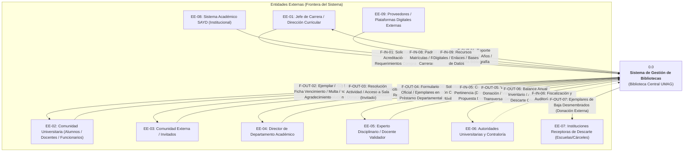
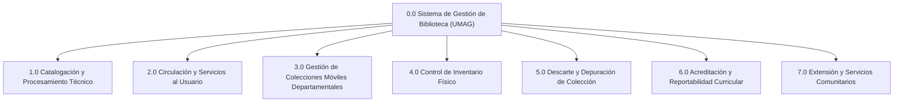

# Estructuración Integral de Procesos del Sistema de Bibliotecas para Modelado DSIA
**Documento de Especificación, Levantamiento y Análisis Funcional**  
**Asignatura:** Diseño de Sistemas de Información Administrativos (DSIA I)  
**Institución:** Universidad de Magallanes (UMAG) — Sistema de Bibliotecas  
**Origen:** Integración y sistematización exhaustiva a partir de `Plantilla preguntas servicios.md` y entrevistas de campo.

---

## 1. Visión General del Sistema y Diagrama de Contexto (DFD Nivel 0)

El **Sistema de Gestión de Bibliotecas (SGB - UMAG)** administra, preserva y provee acceso a los recursos bibliográficos físicos y digitales, equipamiento tecnológico y espacios de estudio de la Universidad de Magallanes. Coordina el flujo de información operativa y estratégica entre la comunidad universitaria (estudiantes, docentes, funcionarios), las jefaturas y direcciones de carrera, directores de departamentos académicos, unidades de acreditación, comités disciplinares, autoridades superiores, organismos de control público (Contraloría) e instituciones comunitarias receptoras de donaciones y material de descarte.



---

## 2. Catálogo de Entidades Externas y Almacenes de Datos

### 2.1. Entidades Externas (Actores de Frontera)

| Código | Entidad Externa | Rol y Responsabilidad Administrativa en el Sistema |
| :--- | :--- | :--- |
| **EE-01** | **Jefe de Carrera / Dirección Curricular** | Solicita reportes de acreditación quinquenal, remite programas académicos con bibliografía básica/complementaria y solicita compras de nuevos títulos. |
| **EE-02** | **Comunidad Universitaria (Estudiantes, Docentes, Funcionarios)** | Usuarios principales de circulación; solicitan libros, salas/logias, computadores y bicicletas; donan material físico a mesón o "libros libres". |
| **EE-03** | **Comunidad Externa / Invitados** | Usuarios no matriculados que acceden a lectura en sala bajo perfil "Invitado", participan en actividades culturales o solicitan espacios para talleres. |
| **EE-04** | **Director de Departamento Académico** | Solicita y suscribe convenios de colecciones móviles departamentales, renueva actas anuales y asume responsabilidad económica por pérdidas o daños. |
| **EE-05** | **Experto Disciplinario / Docente Validador** | Emite visto bueno sobre relevancia curricular en donaciones y aprueba la baja de títulos en la propuesta técnica de descarte (aplicando regla de transversalidad). |
| **EE-06** | **Autoridades Universitarias y Contraloría** | Reciben balances anuales de inventario y nóminas oficiales de pérdidas; fiscalizan el patrimonio bibliográfico de la universidad. |
| **EE-07** | **Instituciones Receptoras de Descarte** | Escuelas vulnerables, recintos penitenciarios y programas de reinserción social que reciben formalmente libros dados de baja técnica. |
| **EE-08** | **Sistema SAYD (Central UMAG)** | Sistema de administración académica externa que provee la nómina de usuarios habilitados, carreras y estado de matrícula. |
| **EE-09** | **Proveedores y Plataformas Digitales** | Editoriales comerciales y plataformas externas de libros electrónicos que suministran licencias y enlaces URL a recursos digitales. |

---

### 2.2. Almacenes de Datos (Data Stores para DFDs)

| Código | Almacén de Datos | Soporte Tecnológico | Datos Almacenados | Responsable / Frecuencia |
| :--- | :--- | :--- | :--- | :--- |
| **D1** | **Catálogo Bibliográfico y Existencias (Horizont)** | Software Horizont (Base de datos relacional) | Registros bibliográficos MARC21, Dewey, Cutter, copias/ejemplares, sede física, estados (*Disponible, En Procesamiento, En Inventario, En Tránsito, Prestado Departamento, Baja*). | Procesos Técnicos / Continua. |
| **D2** | **Registro de Circulación y Transacciones** | Software Horizont (Módulo Préstamos) | Préstamos activos e históricos, fechas de vencimiento, devoluciones, transacciones de logias de estudio, equipamiento y accesos a sala. | Mesón de Circulación / Tiempo real. |
| **D3** | **Usuarios, Roles y Sanciones** | Software Horizont (Módulo Usuarios) | RUT, nombres, estamento/rol (estudiante, docente, funcionario, invitado), historial de multas monetarias sin tope y sanciones de suspensión activa. | Mesón de Circulación / SAYD (semestral/diario). |
| **D4** | **Planilla de Registro Físico e Inventario Preliminar** | Hoja de Cálculo Excel (Archivo local/compartido) | Registro manual cronológico de ingreso: carrera/transversal, N° registro de inventario, autor, título, año, edición, observaciones, origen (compra/donación), timbre. | Procesos Técnicos / Cada ingreso de libro. |
| **D5** | **Repositorio Institucional de Recursos Digitales** | Google Drive Institucional | Archivos PDF digitalizados mediante robot Kabis 700, organizados por carpetas de carrera/asignatura; enlaces a libros comerciales. | Encargado Digitalización / Semanal. |
| **D6** | **Archivo de Colecciones Móviles y Convenios Departamentales** | Carpetas Físicas / Documentos Oficiales | Formularios oficiales de préstamo departamental por 1 año, inventario de ejemplares asignados, firmas de Directores de Depto. y actas de renovación para Contraloría. | Jefatura de Biblioteca / Anual y a demanda. |
| **D7** | **Archivo Oficial de Actas de Descarte y Bajas** | Google Drive Interno / Documentos Oficiales | Actas oficiales de descarte anual, planillas Excel de libros dados de baja, resoluciones de protocolo y constancias de entrega a instituciones comunitarias. | Bibliotecóloga Encargada / Anual. |
| **D8** | **Programas de Estudio y Mallas Curriculares** | Documentos / Correo / Archivos Locales | Programas de asignaturas vigentes con listados de bibliografía básica y complementaria declarada por las carreras. | Jefes de Carrera / Acreditación. |
| **D9** | **Archivo de Gestión, Solicitudes y Extensión** | Bandejas de Correo / Carpetas Locales | Solicitudes de jefes de carrera para acreditación, solicitudes de actividades del Comité Creativo, correspondencia con expertos y reportes de salida. | Administración / Continua. |

---

## 3. Descomposición Jerárquica de Procesos (DFD Nivel 1)

El Sistema de Gestión de Biblioteca se descompone en **7 macroprocesos funcionales**, alineados estrictamente con los servicios levantados en la plantilla:



---

## 4. Especificación Detallada de Cada Proceso

---

### PROCESO 1.0: Catalogación y Procesamiento Técnico

#### 1. Objetivo y Alcance Funcional
Gestionar el ingreso formal de todo material bibliográfico a la biblioteca (físico o digital) derivado de compras, donaciones o digitalización institucional. Comprende el filtrado de pertinencia, registro preliminar de inventario, catalogación normalizada MARC21, procesamiento físico/técnico con medidas de seguridad electromagnética, asignación de sede y digitalización accesible.

#### 2. Subprocesos (DFD Nivel 2)
* **1.1 Filtrar y Validar Donaciones:** Revisión física del estado del ejemplar y consulta disciplinar al docente/experto sobre relevancia curricular.
* **1.2 Registrar Adquisición en Inventario Preliminar:** Asignación manual de correlativo de inventario e inscripción en planilla Excel.
* **1.3 Catalogación Bibliográfica MARC21:** Creación del registro bibliográfico en Horizont con metadatos internacionales, signatura topográfica Dewey y clave Cutter.
* **1.4 Procesamiento Físico y Medidas de Seguridad:** Plastificado, rotulación de tejuelo, timbrado con correlativo, inserción de sensor electromagnético y asignación de sede.
* **1.5 Procesamiento y Digitalización de Recursos:** Escaneo automático con robot Kabis 700 para bibliografía de estudiantes con discapacidad o carreras prioritarias, subida a Google Drive y enlace MARC21 en catálogo online.

#### 3. Detalle Operativo del Proceso (Pregunta 3 de la Plantilla)
* **¿Qué inicia el proceso?:**
  * Llegada de libros donados al mesón de atención o abandonados en el estante de "Libros Libres".
  * Recepción de cargamento de libros comprados según listas solicitadas por docentes y jefes de carrera.
  * Plan de digitalización de bibliografía obligatoria para alumnos con discapacidad o prioridades curriculares.
* **Pasos ordenados y responsables:**
  1. *Filtro inicial de donación (Asistente de mesón / Bibliotecaria):* Si el libro está deteriorado, se deriva inmediatamente a libros libres. Si está en buen estado, se identifica el área y se envía un correo de consulta al experto disciplinario o jefe de carrera. Si el donante está en mesón, se solicita su correo electrónico; de lo contrario, se desliga.
  2. *Recepción de compras (Encargado de adquisiciones):* Todos los libros comprados se ingresan directamente sin filtro de pertinencia (vienen respaldados por lista académica previa).
  3. *Inscripción preliminar en planilla Excel (Asistente de procesos técnicos):* Se registra manualmente: carrera/transversal, número correlativo de registro, autor, título, edición, año, observaciones y modalidad (compra/donación).
  4. *Catalogación en Horizont (Bibliotecólogo catalogador):* Se ingresan los datos descriptivos en formato MARC21. Se asigna signatura Dewey y clave Cutter. Se crea el ejemplar/copia con su sede de destino (Central, Instituto, etc.). El libro queda en estado "En Procesamiento Técnico (PT)".
  5. *Procesamiento físico (Asistente técnico):* Se plastifica el libro, se coloca tejuelo impreso con Dewey/Cutter/año/copia, se estampa timbre institucional con el N° de registro del Excel, se pega código de barras exterior y se inserta cinta electromagnética de seguridad para las antenas de salida.
  6. *Digitalización (Estudiantes capacitados / Encargado digital):* Libros seleccionados se escanean en el robot Kabis 700. El PDF resultante se almacena en el Google Drive de Biblioteca, restringido a correos institucionales `@umag.cl`. En Horizont se genera el registro MARC21 con enlace URL al Drive (sin existencia física).
  7. *Distribución a estantería (Asistentes de sala):* El libro procesado se envía a circulación y se coloca físicamente en estantería abierta según clasificación Dewey.
* **Información requerida y origen:**
  * Datos bibliográficos del ejemplar impreso (portada, pie de imprenta, ISBN).
  * Lista de títulos solicitados por compras (correo de docentes/carreras).
  * Visto bueno del experto disciplinario (correo electrónico).
* **Productos generados y destinatarios:**
  * Correo de agradecimiento emitido al donante (si se capturó contacto).
  * Ejemplar físico completamente habilitado entregado a Circulación.
  * Registro digital accesible vía catálogo OPAC / Drive institucional.
  * Libros descartados preliminarmente depositados en estantería de "Libros Libres".
* **Validaciones y aprobaciones intermedias:**
  * *Regla de Pertinencia por Silencio Administrativo:* El experto disciplinario debe responder el correo de consulta. Si no responde dentro del plazo habitual, **se asume formalmente que el libro no es relevante** y se destina a libros libres.

#### 4. Almacenamiento y Gestión de Datos (Pregunta 4 de la Plantilla)
* **Soportes utilizados:** Planilla Excel local/compartida (`D4`), software Horizont (`D1`), Google Drive institucional (`D5`).
* **Permisos:** Procesos técnicos y catalogadores tienen privilegios de escritura y modificación en Excel y Horizont; usuarios y mesón sólo lectura en catálogo.
* **Duplicidad de datos:** Duplicidad total entre la planilla Excel preliminar y la base de datos Horizont (se digitan dos veces título, autor, año y correlativo).
* **Mantenimiento y actualización:** Se actualiza registro por registro al momento de recibir cada material.

#### 5. Diagnóstico Tecnológico y Problemas Actuales (Pregunta 5 de la Plantilla)
* **Sistemas y comunicación:** Horizont y la planilla Excel no poseen ningún mecanismo de sincronización ni interfaz de importación. Google Drive opera de forma desacoplada al catálogo.
* **Tareas manuales:** Digitación duplicada, plastificado, timbrado manual, consulta de pertinencia caso a caso vía correo, colocación manual en estantes.
* **Puntos de falla y cuellos de botella:**
  * Error humano de ubicación en estanterías físicas al despachar el libro (Horizont no controla balda o pasillo).
  * Vacío legal respecto a derechos de autor en el escaneo de bibliografía a Google Drive.
  * Google Drive no registra estadísticas de acceso, lectura ni descarga por usuario o carrera.
* **Mejora prioritaria:** Integrar el registro preliminar dentro del software central para eliminar la planilla Excel e incorporar un repositorio digital con control de acceso y métricas de lectura.

---

### PROCESO 2.0: Circulación y Servicios al Usuario

#### 1. Objetivo y Alcance Funcional
Gestionar el préstamo, control de permanencia, renovación, devolución y penalización sobre libros físicos, recursos digitales, salas/logias de estudio y equipamiento de apoyo (notebooks, bicicletas, audífonos, mapas), aplicando normativas diferenciadas según perfil de usuario y tipo de recurso.

#### 2. Subprocesos (DFD Nivel 2)
* **2.1 Control de Acceso y Afluencia en Sala:** Registro del RUT de usuarios al ingresar para estadísticas de asistencia (opcional/demanda).
* **2.2 Verificación de Usuario y Privilegios:** Validación de matrícula vigente en SAYD, rol asignado y comprobación de ausencia de bloqueos o multas activas.
* **2.3 Préstamo de Recursos Generales:** Asignación de libros y equipos tecnológicos (notebooks, bicicletas, etc.) mediante lectura óptica de código de barras.
* **2.4 Gestión de Préstamo de Logias de Estudio:** Validación simultánea de un grupo mínimo de 3 estudiantes, asignación de llave con código de barras y control de franja horaria.
* **2.5 Recepción, Devolución y Liberación:** Pistoleo del código de barras al retorno físico, verificación de estado del bien y restitución a estado "Disponible".
* **2.6 Liquidación de Multas y Sanciones:** Cálculo automatizado en Horizont de cobro monetario sin tope y asignación de suspensión temporal de servicios.

#### 3. Detalle Operativo del Proceso (Pregunta 3 de la Plantilla)
* **¿Qué inicia el proceso?:**
  * Presentación física del estudiante, docente, funcionario o invitado en mesón de atención con su RUT.
  * Intención de ingreso a sala de lectura.
  * Búsqueda previa en el OPAC web por disponibilidad.
* **Pasos ordenados y responsables:**
  1. *Registro de entrada (Asistente de mesón):* Al entrar, se solicita RUT al usuario. Históricamente se registraba un préstamo simulado del ítem "puesto de estudio/silla" y devolución inmediata. Debido a colapsos en horas punta, el paso quedó como voluntario/opcional.
  2. *Validación de antecedentes (Asistente de mesón):* El funcionario digita el RUT en Horizont. El sistema muestra si el usuario tiene préstamos vigentes, multas impagas o suspensión por atrasos previos.
  3. *Préstamo de libros o equipamiento:* El usuario entrega el libro o solicita un bien (notebook, bicicleta, audífono, calculadora). El asistente pistolea el código de barras del ítem. En Horizont el ítem pasa de "Disponible" a "Prestado". Se imprime o comunica la fecha de vencimiento.
  4. *Préstamo de logias de estudio:* Para solicitar una sala de estudio grupal (capacidad 6 personas), se exige obligatoriamente la presencia y RUT de **al menos 3 estudiantes concurrentes**. El asistente digita los 3 RUTs en Horizont (donde la logia está catalogada como título y los puestos como copias). Se pistolea la llave con código de barras y se fija la duración parametrizada.
  5. *Acceso a recursos digitales:* Usuarios institucionales abren los enlaces del OPAC vinculados a Google Drive utilizando exclusivamente su correo `@umag.cl`.
  6. *Devolución del recurso:* El usuario entrega el bien en mesón. El asistente lee el código de barras; si está en fecha, el ítem queda "Disponible".
  7. *Aplicación de penalización:* Si el plazo expiró, Horizont genera dos sanciones paralelas: una multa en dinero (acumulativa, sin límite superior reglamentario) y una suspensión temporal de privilegios de préstamo.
* **Información requerida y origen:**
  * RUT del usuario (comprobado en BD Horizont / SAYD).
  * Código de barras adherido al ejemplar, llave de logia o equipo.
  * Parámetros de plazo de préstamo definidos por reglamento según estamento e ítem.
* **Productos generados y destinatarios:**
  * Recurso físico entregado en custodia temporal al solicitante.
  * Ficha o comprobante verbal con fecha y hora exacta de devolución.
  * Notificación de multa monetaria e inhabilitación temporal en caso de atraso.
* **Validaciones y aprobaciones intermedias:**
  * *Regla de las Logias:* Imposibilidad de autorizar préstamo con menos de 3 RUTs registrados en el sistema.
  * *Restricción de Rol Invitado:* Usuarios externos sólo acceden a uso en sala (no pueden retirar bienes a domicilio).
  * *Bloqueo por Morosidad:* Usuarios con multas pendientes o suspensión activa no pueden realizar nuevas transacciones.

#### 4. Almacenamiento y Gestión de Datos (Pregunta 4 de la Plantilla)
* **Soportes utilizados:** Base de datos Horizont (`D1`, `D2`, `D3`).
* **Permisos:** Asistentes y jefatura de mesón pueden consultar usuarios, generar préstamos, devoluciones y condonar/registrar pagos de multas.
* **Duplicidad de datos:** Redundancia de datos de usuario con el sistema central universitario SAYD (no hay sincronización en línea para cambios de carrera o matrícula).
* **Mantenimiento y actualización:** Actualización inmediata por transacción en tiempo real.

#### 5. Diagnóstico Tecnológico y Problemas Actuales (Pregunta 5 de la Plantilla)
* **Sistemas y comunicación:** Horizont opera de manera aislada respecto a los torniquetes o sistemas de credencial universitaria.
* **Tareas manuales:** Digitación manual de RUTs en cada entrada y préstamo; entrega manual de llaves y revisión visual de bicicletas y equipos.
* **Puntos de falla y cuellos de botella:**
  * Filas excesivas en el mesón cuando se intenta registrar el ingreso de alumnos simulando préstamos de sillas ("RUT-presto-devuelvo").
  * Reglamentos de multas y sanciones obsoletos (deudas acumuladas desproporcionadas sin límite superior).
  * Total ausencia de terminales de auto-préstamo (self-checkout).
* **Mejora prioritaria:** Implementar lectura automática de credencial institucional con código QR/RFID para acceso expedito e incorporar módulos de autogestión de préstamos.

---

### PROCESO 3.0: Gestión de Colecciones Móviles Departamentales

#### 1. Objetivo y Alcance Funcional
Regular, tramitar, registrar y fiscalizar el préstamo institucional extendido de conjuntos de libros a las dependencias de departamentos y carreras universitarias (Derecho, Auditoría, Técnico en Enfermería, GAIA Antártica), garantizando la existencia de copias de resguardo en Biblioteca Central y resguardando la responsabilidad patrimonial exigida por Contraloría.

#### 2. Subprocesos (DFD Nivel 2)
* **3.1 Recepción y Análisis de Solicitud Departamental:** Recepción de solicitud por correo del Director de Departamento y validación del cupo de copias en Biblioteca Central.
* **3.2 Formalización y Suscripción del Convenio:** Llenado del Formulario Oficial de Préstamo Departamental con detalle de ejemplares y plazo de 1 año.
* **3.3 Actualización de Estado Patrimonial en Catálogo:** Modificación del estado del ejemplar a "Prestado Departamento" en Horizont previo a la entrega física.
* **3.4 Despacho y Custodia en Departamento:** Traslado de libros y apertura a consulta local para docentes y estudiantes de la unidad.
* **3.5 Monitoreo, Renovación Anual y Cobranza:** Inspección anual de colecciones, persecución activa de renovación de actas y gestión de reposición monetaria por deterioro o pérdida.

#### 3. Detalle Operativo del Proceso (Pregunta 3 de la Plantilla)
* **¿Qué inicia el proceso?:**
  * Solicitud formal o correo electrónico enviado por un Director de Departamento a la Jefa de Biblioteca.
  * Oferta generada desde Biblioteca a partir de un proceso de depuración/descarte con ejemplares útiles para una unidad específica.
* **Pasos ordenados y responsables:**
  1. *Solicitud departamental (Director de Departamento):* Envía correo a Biblioteca indicando los títulos y cantidades que requiere mantener en su facultad o unidad.
  2. *Evaluación de factibilidad (Jefa de Biblioteca):* Se revisa el inventario en Horizont. **Condición estricta:** Debe asegurarse que permanezca en Biblioteca Central al menos 1 copia física disponible para la comunidad general. Si la solicitud deja a la biblioteca sin ejemplares, se rechaza o ajusta la cantidad.
  3. *Confección de formulario oficial (Asistente de administración de biblioteca):* Se completa la ficha oficial con los códigos de barras, títulos, fecha de entrega y plazo contractual de 1 año.
  4. *Registro informático (Bibliotecaria):* En Horizont se modifica el estado de cada copia a "Prestado departamento" ANTES de despachar físicamente el material.
  5. *Entrega física y firma:* El Director de Departamento (o encargado designado) firma la recepción conforme, asumiendo la custodia de los ejemplares.
  6. *Disponibilidad en destino:* Los libros quedan a disposición de alumnos y académicos en la sala de lectura del departamento respectivo.
  7. *Renovación anual e insistencia:* Cumplido el año de vigencia, Biblioteca debe gestionar la renovación. Al no existir un sistema automatizado, el personal de biblioteca debe enviar correos e insistir de forma presencial para conseguir la firma del acta de renovación.
  8. *Control de daños o pérdidas:* Si un ejemplar se extravía o sufre deterioro irreparable mientras está bajo custodia del departamento, la unidad académica tiene la obligación reglamentaria de reponer su valor monetario a la Biblioteca.
* **Información requerida y origen:**
  * Correo de solicitud con nómina de títulos (Director de Departamento).
  * Existencias de copias en catálogo Horizont (`D1`).
  * Formulario oficial de préstamo de colección móvil (`D6`).
* **Productos generados y destinatarios:**
  * Formulario Oficial de Préstamo Departamental firmado por ambas partes.
  * Lote de libros rotulados entregados al departamento.
  * Nómina consolidada de colecciones departamentales actualizada para fiscalización de Contraloría.
* **Validaciones y aprobaciones intermedias:**
  * *Regla de Copia de Seguridad:* Prohibición absoluta de ceder ejemplares en colección móvil si no queda como mínimo una copia física de reserva en Biblioteca Central.
  * Aprobación obligatoria y firma de la Jefa de Biblioteca y del Director de Departamento solicitante.

#### 4. Almacenamiento y Gestión de Datos (Pregunta 4 de la Plantilla)
* **Soportes utilizados:** Software Horizont (estado de copia `D1`), carpetas con formularios físicos y planillas de control en red (`D6`).
* **Permisos:** Catalogación y Jefatura de Biblioteca pueden asignar y revocar el estado "Prestado departamento".
* **Duplicidad de datos:** Los libros figuran en Horizont con estado especial y a su vez en listados paralelos en papel o planillas para la Contraloría.
* **Mantenimiento y actualización:** Se actualiza al constituirse el préstamo, al renovarse anualmente o ante una pérdida informada.

#### 5. Diagnóstico Tecnológico y Problemas Actuales (Pregunta 5 de la Plantilla)
* **Sistemas y comunicación:** Horizont registra el estado pero no emite alertas programadas de vencimiento del período de 1 año.
* **Tareas manuales:** Solicitudes en texto libre vía correo electrónico; gestión presencial insistente para conseguir las firmas de renovación anual.
* **Puntos de falla y cuellos de botella:**
  * Descoordinación en los plazos de renovación y riesgo de observaciones graves por parte de la Contraloría universitaria.
  * Falta de inventario periódico in situ en los departamentos para constatar el estado real de los ejemplares prestados.
* **Mejora prioritaria:** Implementar un módulo digital de convenios interdepartamentales en el sistema, con alertas automáticas de caducidad anual y trazabilidad patrimonial directa ante auditorías.

---

### PROCESO 4.0: Control de Inventario Físico

#### 1. Objetivo y Alcance Funcional
Verificar de manera sistemática y periódica la correspondencia entre la existencia física real de recursos bibliográficos en estanterías y los registros lógicos del catálogo Horizont, detectando pérdidas, regularizando ubicaciones erróneas y aplicando la regla de prescripción de 2 años previa a la baja patrimonial.

#### 2. Subprocesos (DFD Nivel 2)
* **4.1 Reordenamiento Físico Continuo:** Alineación y revisión diaria de estantes según signatura Dewey/Cutter ejecutada por asistentes de sala.
* **4.2 Planificación y Cambio de Estado Masivo:** Delimitación del alcance (sede, colección, estantería) y cambio de estado a "En Inventario" en Horizont.
* **4.3 Pistoleo y Captura Óptica de Ejemplares:** Lectura de códigos de barra libro por libro con lector óptico portátil (cambio de estado a "En Tránsito / Verificado").
* **4.4 Conciliación y Búsqueda de Discrepancias:** Cruce de no leídos y rastreo físico secundario exhaustivo en colecciones anexas.
* **4.5 Declaración de Extravío y Control de Antigüedad (2 Años):** Asignación de estado "Extraviado" y seguimiento de libros no hallados durante 2 inventarios consecutivos.
* **4.6 Elaboración de Balance e Informe a Autoridades:** Emisión del balance estadístico final y elevación formal a Rectoría y Decanatos.

#### 3. Detalle Operativo del Proceso (Pregunta 3 de la Plantilla)
* **¿Qué inicia el proceso?:**
  * Cumplimiento del cronograma institucional anual de inventario (planificación fija, duración aproximada de 3 meses).
  * Rutina de apertura y cierre de estanterías en turnos diarios de asistentes.
* **Pasos ordenados y responsables:**
  1. *Ordenamiento continuo (Asistentes de sala):* Durante todo el año, en horarios fijados, las asistentes ordenan rigurosamente libro por libro en las estanterías según su clasificación Dewey. Es el prerrequisito para que el inventario no fracase.
  2. *Selección de alcance (Bibliotecaria supervisora):* Se define la sede (Central, Institutos), colección temática y tipología documental. Solo se inventaría lo que está en estantería o disponible (se excluyen préstamos vigentes).
  3. *Bloqueo lógico de colección (Bibliotecaria):* En Horizont se seleccionan los ejemplares del alcance y se les cambia el estado en masa a "En Inventario".
  4. *Escaneo físico (Asistentes y personal técnico):* Recorren los pasillos con pistolas lectoras escaneando el código de barras de cada ejemplar físico. Al ser leído, el software cambia su estado automáticamente a "En Tránsito / Verificado".
  5. *Generación de discrepancias:* Se extrae el reporte de ejemplares que se mantuvieron en estado "En Inventario" (no fueron leídos).
  6. *Segunda revisión manual:* Las asistentes realizan una búsqueda manual minuciosa de los títulos faltantes en estantes adyacentes, mesones de consulta y áreas técnicas.
  7. *Aplicación de la regla de los 2 años:* Los libros que definitivamente no aparecen pasan a estado "Extraviado". Se comparan con la planilla de extravíos del inventario del año anterior. Si un libro cumple **2 años consecutivos en condición de extraviado sin reaparecer**, se autoriza su eliminación del catálogo Horizont.
  8. *Cierre y balance final (Bibliotecaria Jefa):* Se consolida la planilla Excel de inventario, se calcula la tasa de pérdida y se redacta el Informe de Balance Final remitido a las Autoridades Universitarias.
* **Información requerida y origen:**
  * Lectura óptica de códigos de barra físicos.
  * Registros bibliográficos y existencias en Horizont (`D1`).
  * Historial consolidado de libros extraviados en inventarios precedentes (`D4`).
* **Productos generados y destinatarios:**
  * Planilla Excel consolidada de balance de inventario.
  * Listado nominal de libros extraviados (nuevos y reincidentes de 2 años).
  * Informe oficial de balance elevado a Autoridades Universitarias (Rectoría, Dirección de Finanzas).
* **Validaciones y aprobaciones intermedias:**
  * Supervisión directa de la bibliotecaria jefa.
  * *Regla de Caducidad por Extravío:* Ningún libro puede ser eliminado del sistema de forma prematura; se exige acreditar formalmente 2 años consecutivos en lista de extravíos.

#### 4. Almacenamiento y Gestión de Datos (Pregunta 4 de la Plantilla)
* **Soportes utilizados:** Software Horizont (estados de ejemplar `D1`), hojas de cálculo Excel locales (`D4`), informe impreso/digital de balance.
* **Permisos:** Personal técnico pistolea; bibliotecaria jefa autoriza transiciones a "Extraviado" y eliminación final.
* **Duplicidad de datos:** La lista de libros perdidos y el balance global se estructuran en archivos Excel externos sin integración con el módulo patrimonial institucional.
* **Mantenimiento y actualización:** Intensivo durante el trimestre de inventario; mantenimiento de orden físico diario.

#### 5. Diagnóstico Tecnológico y Problemas Actuales (Pregunta 5 de la Plantilla)
* **Sistemas y comunicación:** Horizont carece de geolocalización o registro del estante/balda física del libro; el sistema solo sabe que el libro pertenece a una sede general.
* **Tareas manuales:** Escaneo libro por libro a pie de pasillo, búsqueda física a ciegas de libros extraviados, ordenamiento manual continuo.
* **Puntos de falla y cuellos de botella:**
  * Duración desmedida del inventario (alrededor de 3 meses de absorción de personal).
  * Un libro mal colocado en un estante diferente queda como "no leído" y se clasifica erróneamente como extraviado.
* **Mejora prioritaria:** Incorporar lectores RFID para inventariado por proximidad de estanterías completas en minutos y asignar ubicaciones topográficas detalladas (pasillo, estante, balda) en la base de datos.

---

### PROCESO 5.0: Descarte y Depuración de Colección

#### 1. Objetivo y Alcance Funcional
Gestionar la depuración técnica, desincorporación patrimonial, desmembrete físico y reasignación comunitaria de libros obsoletos, deteriorados o irrelevantes, formalizando el proceso mediante propuestas técnicas, validación estricta de expertos disciplinares (con regla de transversalidad) y actas oficiales de baja.

#### 2. Subprocesos (DFD Nivel 2)
* **5.1 Confección de Propuesta Técnica de Descarte:** Análisis bibliométrico en Horizont y selección de candidatos según criterios del reglamento oficial de descarte.
* **5.2 Extracción y Filtrado Curricular:** Exportación masiva de datos desde Horizont y clasificación manual por carrera, temática y métricas de circulación.
* **5.3 Consulta y Validación Disciplinar:** Envío de nóminas a Jefes de Carrera / Docentes y aplicación de la regla de transversalidad (con insistencia obligatoria).
* **5.4 Desmembrete y Procesamiento Físico de Baja:** Retiro manual de tejuelos, timbres institucionales, códigos de barra y tiras electromagnéticas.
* **5.5 Formalización del Acta Oficial de Descarte:** Elaboración de acta en Google Drive institucional y eliminación lógica de registros en Horizont.
* **5.6 Donación a Entidades Receptoras Externas:** Embalaje y transferencia física a colegios, recintos penitenciarios o programas sociales.

#### 3. Detalle Operativo del Proceso (Pregunta 3 de la Plantilla)
* **¿Qué inicia el proceso?:**
  * Cronograma anual de descarte orientado a la gestión eficiente del espacio físico (meta fijada: descartar aproximadamente 1.000 copias anuales).
  * Detección de material con daño biológico, rotura irreparable o soportes físicos obsoletos.
* **Pasos ordenados y responsables:**
  1. *Elaboración de propuesta técnica (Bibliotecóloga encargada):* Aplica el reglamento oficial de descarte de la universidad. Considera causales taxativas:
     - Libros sin solicitudes de préstamo en los últimos 30 años.
     - Material obsoleto con más de 5 años de antigüedad en disciplinas científicas/tecnológicas.
     - Deterioro físico irreparable o riesgo biológico (hongos, humedad).
     - Soportes descontinuados no legibles (casetes, diskettes de 3½, CD-ROMs).
     - Fuerza mayor.
     La propuesta establece: títulos, cantidad de copias a descartar, causa técnica justificada y sugerencia de destino final.
  2. *Extracción y segmentación de datos (Bibliotecaria):* Se exporta desde Horizont un Excel masivo con el catálogo total de la biblioteca, ordenando manualmente por número histórico de préstamos y fecha de último préstamo. Se clasifica manualmente por áreas temáticas y carreras.
  3. *Consulta a expertos disciplinares (Bibliotecaria):* Se envía por correo electrónico al Jefe de Carrera o Director de Departamento la propuesta técnica en Excel adjuntando la resolución y protocolo de descarte.
  4. *Evaluación y regla de transversalidad (Experto disciplinario):* El docente experto responde indicando cuáles libros autoriza a descartar y cuáles deben conservarse.
     - **Regla de Transversalidad:** Si un libro candidato al descarte es de carácter transversal (usado por más de una carrera), se envía la consulta a todas las carreras involucradas. **Basta con que una sola carrera indique que el libro es necesario para que sea excluido inmediatamente del descarte y devuelto a estantería.**
     - **Obligatoriedad de Respuesta:** No existe silencio positivo ni negativo; la respuesta del experto es mandataria. Si no responden, la biblioteca insiste formalmente hasta obtener la resolución.
  5. *Descarte físico y desmembrete (Personal técnico):* A las copias cuya baja fue aprobada, se les retira físicamente el membrete exterior, se inutiliza el timbre institucional con un sello de "Dado de Baja", se arranca el código de barras y se retira la cinta magnética de seguridad.
  6. *Transición en sistema Horizont:* Los ítems seleccionados se cambian en Horizont al estado "Dado de baja".
  7. *Emisión del Acta Oficial de Descarte (Bibliotecaria Jefa):* Se confecciona el Acta Oficial de Descarte adjuntando la nómina en Excel, la cual se archiva en el Google Drive interno de Biblioteca. Una vez formalizada el acta, se eliminan definitivamente los registros del software Horizont.
  8. *Entrega comunitaria (Jefa de biblioteca / Logística):* Se coordina con entidades comunitarias (colegios vulnerables, cárceles, recintos de reinserción social) para entregarles los libros desmembrados en donación externa.
* **Información requerida y origen:**
  * Reporte masivo de circulación histórica y antigüedad exportado de Horizont (`D1`).
  * Reglamento institucional de descarte.
  * Respuestas y validaciones emitidas por correo por directores y expertos disciplinares (`EE-05`).
* **Productos generados y destinatarios:**
  * Propuesta técnica de descarte en planilla Excel.
  * Dictamen de visto bueno/rechazo de los expertos disciplinares.
  * Acta Oficial de Descarte firmada y archivada en Google Drive (`D7`).
  * Lotes de libros físicos dados de baja y entregados a Instituciones Receptoras (`EE-07`).
* **Validaciones y aprobaciones intermedias:**
  * Visto bueno explícito y documentado del experto disciplinario.
  * Aplicación estricta de la regla de salvaguarda de transversalidad.
  * Firma formal del Acta Oficial de Descarte previo a la eliminación en el software.

#### 4. Almacenamiento y Gestión de Datos (Pregunta 4 de la Plantilla)
* **Soportes utilizados:** Software Horizont (`D1`), planillas Excel de análisis local, Google Drive institucional (`D7`) para resguardo de actas oficiales.
* **Permisos:** Bibliotecóloga formula la propuesta; directores de carrera autorizan títulos; Jefa de Biblioteca formaliza el acta y ordena la purga en Horizont.
* **Duplicidad de datos:** Manejo redundante de nóminas en Excel, correos de intercambio y registros transitorios en Horizont.
* **Mantenimiento y actualización:** Proceso ejecutado con frecuencia anual.

#### 5. Diagnóstico Tecnológico y Problemas Actuales (Pregunta 5 de la Plantilla)
* **Sistemas y comunicación:** Horizont no cuenta con un módulo de descarte; la extracción se realiza mediante un volcado bruto que requiere depuración manual exhaustiva en Excel.
* **Tareas manuales:** Filtrado manual de miles de filas en Excel, redacción de correos caso a caso, seguimiento de respuestas no estandarizadas (unos expertos responden sí/no, otros con notas anexas) y desmembrete físico manual (extremadamente tedioso).
* **Puntos de falla y cuellos de botella:**
  * Retrasos severos en la espera de respuestas de docentes para autorizar la baja.
  * Formato heterogéneo de respuestas que dificulta la consolidación del acta final.
* **Mejora prioritaria:** Desarrollar un módulo de gestión de descarte en el sistema con cálculo automático de criterios de obsolescencia y un portal web para que los directores validen o veten los títulos con un solo clic.

---

### PROCESO 6.0: Acreditación y Reportabilidad Curricular

#### 1. Objetivo y Alcance Funcional
Recopilar, procesar, auditar y consolidar indicadores de disponibilidad, uso y vigencia de los recursos bibliográficos (básicos y complementarios) y afluencia de estudiantes en los últimos 5 años, satisfaciendo los estándares de autoevaluación y acreditación nacional/internacional de cada carrera.

#### 2. Subprocesos (DFD Nivel 2)
* **6.1 Recepción y Calificación del Requerimiento:** Recepción de solicitud de acreditación emitida por la carrera y obtención de los programas de asignaturas vigentes.
* **6.2 Extracción de Métricas de Circulación:** Extracción de datos crudos de transacciones y catálogo desde Horizont (o extracción filtrada del sistema en desarrollo).
* **6.3 Cruce Curricular y Padrón Estudiantil:** Cotejo manual de los RUTs de alumnos matriculados y títulos declarados como bibliografía básica y complementaria.
* **6.4 Control de Ventana de Observación (5 Años) y Obsolescencia:** Filtrado estricto del uso en los últimos 5 años y cálculo de antigüedad editorial de los recursos.
* **6.5 Generación de Alerta Preventiva Curricular:** Emisión de advertencias a la carrera sobre bibliografía desactualizada (> 5 años) o baja disponibilidad (proceso ideal deseado).
* **6.6 Consolidación y Despacho del Cuadro de Acreditación:** Llenado del cuadro resumen oficial, adjunción de planillas de detalle y despacho por correo electrónico al Jefe de Carrera.

#### 3. Detalle Operativo del Proceso (Pregunta 3 de la Plantilla)
* **¿Qué inicia el proceso?:**
  * Recepción de correo electrónico del Jefe de Carrera solicitando el reporte de acreditación (en cualquier fecha del año).
  * Cronograma anual de carreras convocadas a procesos de autoevaluación o acreditación CNA.
* **Pasos ordenados y responsables:**
  1. *Recepción del requerimiento (Bibliotecaria encargada de acreditación):* El jefe de carrera solicita el reporte por correo, frecuentemente de manera informal o adjuntando una plantilla vacía sin especificaciones estándar.
  2. *Revisión de programas académicos:* Se recopilan los programas de las asignaturas de la carrera con sus listas de bibliografía obligatoria y complementaria.
  3. *Extracción de transacciones desde Horizont:* Históricamente se exporta una planilla Excel general masiva con la totalidad de préstamos y títulos de la biblioteca. Con el sistema nuevo en desarrollo, el Excel ahora entrega únicamente los títulos solicitados por la carrera.
  4. *Cruce de información (Bibliotecaria):* Se cruzan manualmente en Excel los títulos de los programas con las existencias en biblioteca y los préstamos asociados a los RUTs de los estudiantes de la carrera en los últimos 5 años. También se incorporan los registros de uso en sala.
  5. *Detección de obsolescencia y alerta temprana (Mejora en implementación):* Se verifica la antigüedad editorial. Si los libros declarados superan los 5 años de antigüedad o registran stock crítico, se elabora un aviso preventivo para que la carrera actualice su programa o solicite compras.
  6. *Confección y despacho del reporte:* La bibliotecaria completa manualmente el cuadro resumen de acreditación, anexa la planilla Excel con el desglose de bibliografía y lo envía vía correo electrónico al Jefe de Carrera solicitante.
* **Información requerida y origen:**
  * Solicitud de acreditación (correo electrónico de Jefatura de Carrera).
  * Programas de estudio de asignaturas (`D8`).
  * Reporte masivo de préstamos y existencias de Horizont (`D1`, `D2`).
  * Padrón de estudiantes y matrículas por carrera provisto por SAYD (`EE-08`).
* **Productos generados y destinatarios:**
  * Cuadro resumen con indicadores consolidados de uso y cobertura bibliográfica.
  * Planilla Excel con el detalle del cruce bibliográfico de los últimos 5 años.
  * Informe preventivo de obsolescencia bibliográfica para la carrera.
* **Validaciones y aprobaciones intermedias:**
  * *Ventana de Observación Quinquenal:* Los datos deben corresponder estrictamente al intervalo de 5 años hacia atrás desde la fecha de solicitud (estándar de acreditación).
  * Supervisión y firma de la Bibliotecaria Encargada antes de su despacho.

#### 4. Almacenamiento y Gestión de Datos (Pregunta 4 de la Plantilla)
* **Soportes utilizados:** Base de datos Horizont, planillas Excel locales, carpetas personales de correo (`D9`).
* **Permisos:** Bibliotecaria de acreditación consulta Horizont y elabora planillas; el solicitante sólo recibe el reporte final.
* **Duplicidad de datos:** Redundancia de cálculos y cruces temporales en múltiples versiones de archivos Excel guardados localmente; los reportes generados **no quedan almacenados en un repositorio institucional oficial**.
* **Mantenimiento y actualización:** Se procesa bajo demanda en cada período de acreditación de carrera.

#### 5. Diagnóstico Tecnológico y Problemas Actuales (Pregunta 5 de la Plantilla)
* **Sistemas y comunicación:** No existe conexión entre el sistema de biblioteca (Horizont) y los sistemas curriculares/académicos de la UMAG. El nuevo sistema en construcción reduce el tamaño del Excel pero **no automatiza la reportabilidad final**.
* **Tareas manuales:** Cruce de datos manual "al ojo", manipulación de grandes volúmenes en Excel, redacción individual de cuadros y despacho por correo informal.
* **Puntos de falla y cuellos de botella:**
  * Elevada probabilidad de errores humanos y datos duplicados en el informe.
  * Pérdida de trazabilidad al no archivarse los reportes en un sistema centralizado.
  * Niveles de madurez: La acreditación se encuentra en un **nivel básico (artesanal y manual)**; la aspiración es alcanzar el **nivel avanzado (generación del informe completo con un solo clic)**.
* **Mejora prioritaria:** Implementar un motor de reportabilidad automatizado que vincule en tiempo real las mallas curriculares, el historial de circulación y genere el cuadro oficial de acreditación al presionar un botón.

---

### PROCESO 7.0: Extensión y Servicios Comunitarios

#### 1. Objetivo y Alcance Funcional
Coordinar, evaluar, calendarizar y ejecutar actividades culturales, académicas, de vinculación comunitaria y de Ciencia Abierta (talleres de escritura, actividades infantiles de invierno, visitas guiadas, ferias, repositorios abiertos), administrando el acceso a sala de usuarios externos bajo el perfil "Invitado" y canalizando las propuestas mediante un Comité Creativo multidisciplinario.

#### 2. Subprocesos (DFD Nivel 2)
* **7.1 Formulación y Captura de Propuestas de Actividad:**
  * *Iniciativa interna:* Propuestas de la Jefa de Biblioteca o funcionarios (talleres, actividades de invierno con voluntarios).
  * *Solicitud externa:* Requerimientos enviados por correo a Administración por docentes, alumnos o instituciones del medio externo.
* **7.2 Evaluación Multidisciplinaria por el Comité Creativo:** Análisis semestral de viabilidad, disponibilidad física, coincidencia de fechas y complejidad logística.
* **7.3 Resolución, Ajuste y Notificación:** Emisión de visto bueno, rechazo o requerimiento de reconsideración comunicado por correo formal.
* **7.4 Despliegue Logístico y Ejecución:** Reserva de espacios, asignación de equipos, coordinación de personal/voluntarios y realización del evento.
* **7.5 Control de Acceso y Atención a Invitados:** Registro en mesón de asistentes no universitarios bajo el perfil "Invitado" (préstamo de puesto para permanencia en sala).
* **7.6 Difusión y Compromisos de Ciencia Abierta:** Gestión de acceso abierto al conocimiento, ciencia ciudadana, datos abiertos e integración en eventos institucionales ("Universidad Abierta").
* **7.7 Evaluación y Cierre de Actividad:** Recopilación informal de retroalimentación de la jornada (actualmente deficiente).

#### 3. Detalle Operativo del Proceso (Pregunta 3 de la Plantilla)
* **¿Qué inicia el proceso?:**
  * Planificación mental de la Jefa de Biblioteca orientada a cumplir el rol social universitario.
  * Solicitud de uso de espacios o co-organización enviada por correo por entidades externas o docentes.
  * Convocatorias institucionales a ferias, semanas universitarias o iniciativas de Ciencia Abierta.
* **Pasos ordenados y responsables:**
  1. *Origen de la iniciativa:*
     - Interna: Talleres de escritura creativa para universitarios o actividades recreativas de invierno para niños organizadas con personal y voluntarios de la biblioteca.
     - Externa: Correos dirigidos a Administración por instituciones externas solicitando salas o colaboración. No existe formulario estandarizado.
  2. *Sesión del Comité Creativo de Biblioteca:*
     - Órgano colegiado que se renueva semestralmente por designación discrecional de la Jefa de Biblioteca.
     - Integrado por representantes de diversas áreas funcionales: recursos físicos, informática/tecnología, bibliotecólogos, procesos técnicos y asistentes de mesón.
     - Evalúa la factibilidad técnica, el cruce con otras actividades y la complejidad operativa.
  3. *Resolución:* El comité emite visto bueno o rechazo. Si se rechaza, la propuesta puede ser ajustada en fecha o formato y someterse a reconsideración. Se responde al solicitante vía correo electrónico.
  4. *Ejecución de la actividad:* El equipo asigna salas, coordina recursos audiovisuales y voluntarios.
  5. *Acceso a la comunidad externa:* Cualquier persona puede ingresar a la biblioteca. Si el participante no figura en la base de datos de Horizont, se le asigna el rol genérico "Invitado" y se le registra el ingreso prestando una silla. Los invitados solo tienen derecho a servicios dentro del recinto.
  6. *Servicios de Ciencia Abierta:* La biblioteca actúa como unidad de apoyo para difundir investigaciones universitarias, repositorios de acceso abierto, laboratorios y proyectos de ciencia ciudadana.
  7. *Cierre y retroalimentación:* Tras la realización de la actividad no se levantan encuestas de satisfacción ni se elaboran informes formales de balance; el retorno se basa únicamente en comentarios verbales informales ("boca a boca").
* **Información requerida y origen:**
  * Propuesta o correo del solicitante con fechas, público esperado y requerimientos técnicos (`EE-03`).
  * Agenda de salas y disponibilidad de equipamiento en biblioteca.
  * Directrices y mandatos institucionales de Ciencia Abierta.
* **Productos generados y destinatarios:**
  * Correo formal de aprobación, rechazo o ajuste remitido al solicitante.
  * Talleres y actividades ejecutadas abiertas a la comunidad.
  * Registro transitorio de acceso a sala para usuarios invitados (`D2`, `D3`).
* **Validaciones y aprobaciones intermedias:**
  * Visto bueno del Comité Creativo de Biblioteca.
  * Aprobación ejecutiva final de la Jefa de Biblioteca.

#### 4. Almacenamiento y Gestión de Datos (Pregunta 4 de la Plantilla)
* **Soportes utilizados:** Software Horizont (cuentas de usuarios "Invitado" `D3`), bandejas de correo electrónico y carpetas locales (`D9`).
* **Permisos:** Mesón asigna roles de invitado; comité creativo y jefatura gestionan reservas y correspondencia.
* **Duplicidad de datos:** Inexistente por falta de registros formales; la información de planificación y compromisos reside en la memoria de la jefatura o en correos dispersos.
* **Mantenimiento y actualización:** Bajo demanda ante cada evento calendarizado.

#### 5. Diagnóstico Tecnológico y Problemas Actuales (Pregunta 5 de la Plantilla)
* **Sistemas y comunicación:** Inexistencia total de un sistema o portal de agenda cultural; las solicitudes llegan por canales heterogéneos sin formulario oficial.
* **Tareas manuales:** Coordinación verbal, revisión de cruces de fechas sin calendario compartido, registro manual en mesón de asistentes externos.
* **Puntos de falla y cuellos de botella:**
  * Pérdida de memoria institucional: No quedan registros estadísticos, actas ni informes de impacto tras las actividades realizadas.
  * Falta de retroalimentación estructurada: Inexistencia de encuestas de satisfacción a los participantes.
* **Mejora prioritaria:** Desarrollar un portal web público de vinculación comunitaria que permita ingresar solicitudes estandarizadas de uso de espacio, gestionar un calendario único para el Comité Creativo y capturar encuestas automáticas de satisfacción post-evento.

---

## 5. Matriz CRUD Consolidada (Procesos vs Almacenes de Datos)

Esta matriz resume las interacciones entre los **7 macroprocesos** y los **9 almacenes de datos**, garantizando la consistencia analítica para el diseño de los DFDs de Niveles 1 y 2:

*(**C**: Create / Registrar, **R**: Read / Consultar, **U**: Update / Modificar, **D**: Delete / Dar de baja)*

| Macroproceso DSIA | D1: Catálogo Horizont | D2: Circulación Horizont | D3: Usuarios Horizont | D4: Excel Registro Físico | D5: Repositorio Drive | D6: Convenios Colección Móvil | D7: Actas Descarte Drive | D8: Mallas y Programas | D9: Solicitudes y Reportes |
| :--- | :---: | :---: | :---: | :---: | :---: | :---: | :---: | :---: | :---: |
| **1.0 Catalogación y Procesamiento Técnico** | **C / U** | — | — | **C / U** | **C** | — | — | **R** | **R / C** |
| **2.0 Circulación y Servicios al Usuario** | **R / U** | **C / U** | **R / U** | — | **R** | — | — | — | — |
| **3.0 Gestión de Colecciones Móviles** | **R / U** | **R** | **R** | — | — | **C / U** | — | — | **C / R** |
| **4.0 Control de Inventario Físico** | **R / U / D** | **R** | — | **C / U** | — | **R** | — | — | **C** |
| **5.0 Descarte y Depuración de Colección** | **R / U / D** | **R** | — | **R** | — | **R** | **C** | **R** | **C / R** |
| **6.0 Acreditación y Reportabilidad Curricular** | **R** | **R** | **R** | **R** | — | — | — | **R** | **C** |
| **7.0 Extensión y Servicios Comunitarios** | **R** | **C** | **R / C** | — | — | — | — | — | **C / R** |

---

## 6. Catálogo de Flujos de Datos para Diagramación DSIA

### 6.1. Flujos Entrantes al Sistema (Inbound Data Flows)

| Código | Nombre del Flujo | Origen (Entidad Externa) | Proceso Destino | Contenido de Datos |
| :--- | :--- | :--- | :--- | :--- |
| **F-IN-01** | *Solicitud de Acreditación* | EE-01: Jefe de Carrera | 6.0 Acreditación | Nombre de carrera, programas académicos, asignaturas y período solicitado. |
| **F-IN-02** | *Lista de Títulos Requeridos* | EE-01: Jefe de Carrera / Docente | 1.0 Catalogación | Listado de títulos a adquirir por compra con especificación bibliográfica. |
| **F-IN-03** | *Ejemplar Físico Donado* | EE-02: Comunidad Universitaria | 1.0 Catalogación | Libro físico donado junto con datos de contacto del donante. |
| **F-IN-04** | *Concepto de Relevancia Curricular* | EE-05: Experto Disciplinario | 1.0 Catalogación | Dictamen por correo sobre si la donación es útil para el alumnado. |
| **F-IN-05** | *Solicitud de Préstamo / RUT* | EE-02: Comunidad Universitaria | 2.0 Circulación | RUT del usuario y código de barras del libro, equipo o logia solicitada. |
| **F-IN-06** | *RUTs Concurrentes para Logia* | EE-02: Comunidad Universitaria | 2.0 Circulación | Registro simultáneo de mínimo 3 RUTs de estudiantes para asignar sala. |
| **F-IN-07** | *Devolución de Ejemplar o Recurso* | EE-02: Comunidad Universitaria | 2.0 Circulación | Retorno físico del ítem para lectura de código de barras y liberación. |
| **F-IN-08** | *Solicitud de Colección Móvil* | EE-04: Director de Departamento | 3.0 Colecciones Móviles | Correo con listado de libros requeridos para custodia departamental. |
| **F-IN-09** | *Acta de Renovación Departamental* | EE-04: Director de Departamento | 3.0 Colecciones Móviles | Firma del documento de extensión de préstamo por 1 año adicional. |
| **F-IN-10** | *Validación Transversal de Descarte*| EE-05: Experto Disciplinario | 5.0 Descarte | Aprobación o veto de baja para libros de la propuesta técnica. |
| **F-IN-11** | *Propuesta de Actividad Externa* | EE-03: Comunidad Externa | 7.0 Extensión | Correo con descripción de evento, público esperado y requerimientos. |
| **F-IN-12** | *Registro de Entrada en Sala* | EE-02 / EE-03: Usuarios / Invitados | 2.0 Circulación | Presentación de RUT para registro de afluencia (opcional). |
| **F-IN-13** | *Padrón de Matrículas SAYD* | EE-08: Sistema SAYD | 2.0 Circulación | Nómina institucional con RUT, carreras y estados de matrícula de alumnos. |
| **F-IN-14** | *Recursos Digitales y Licencias* | EE-09: Proveedores Digitales | 1.0 Catalogación | Archivos, metadatos y enlaces URL para libros electrónicos suscritos. |

---

### 6.2. Flujos Salientes del Sistema (Outbound Data Flows)

| Código | Nombre del Flujo | Proceso Origen | Destino (Entidad Externa) | Contenido de Datos |
| :--- | :--- | :--- | :--- | :--- |
| **F-OUT-01** | *Reporte Quinquenal de Acreditación*| 6.0 Acreditación | EE-01: Jefe de Carrera | Cuadro resumen oficial con indicadores de cobertura y uso en 5 años. |
| **F-OUT-02** | *Alerta de Bibliografía Obsoleta* | 6.0 Acreditación | EE-01: Jefe de Carrera | Notificación preventiva de títulos con antigüedad > 5 años o bajo stock. |
| **F-OUT-03** | *Recurso Entregado y Comprobante* | 2.0 Circulación | EE-02: Comunidad Universitaria | Entrega física del bien y fijación de fecha y hora máxima de devolución. |
| **F-OUT-04** | *Notificación de Multa y Suspensión* | 2.0 Circulación | EE-02: Comunidad Universitaria | Liquidación de cobro monetario y período de inhabilitación por morosidad. |
| **F-OUT-05** | *Agradecimiento de Donación* | 1.0 Catalogación | EE-02: Comunidad Universitaria | Correo de agradecimiento institucional al donante del ejemplar. |
| **F-OUT-06** | *Formulario Oficial de Colección Móvil*| 3.0 Colecciones Móviles | EE-04: Director de Departamento | Ficha con nómina de títulos en custodia, vigencia de 1 año y responsabilidades. |
| **F-OUT-07** | *Balance Anual e Informe de Pérdidas*| 4.0 Control de Inventario | EE-06: Autoridades Universitarias | Estadísticas de colección y nómina de libros eliminados tras 2 años extraviados. |
| **F-OUT-08** | *Consulta de Pertinencia Curricular* | 1.0 Catalogación | EE-05: Experto Disciplinario | Correo de consulta sobre valor académico de libro donado. |
| **F-OUT-09** | *Propuesta Técnica de Descarte* | 5.0 Descarte | EE-05: Experto Disciplinario | Nómina en Excel con títulos candidatos a baja, préstamos históricos y causas. |
| **F-OUT-10** | *Acta Oficial de Descarte Consolidada*| 5.0 Descarte | EE-06: Autoridades y Contraloría| Expediente de libros dados de baja para regularización patrimonial. |
| **F-OUT-11** | *Lote de Libros en Donación Externa*| 5.0 Descarte | EE-07: Instituciones Receptoras | Ejemplares físicos desmembrados para colegios y centros penitenciarios. |
| **F-OUT-12** | *Resolución de Actividad Comunitaria*| 7.0 Extensión | EE-03: Comunidad Externa | Respuesta con visto bueno o rechazo emitida por el Comité Creativo. |
| **F-OUT-13** | *Credencial / Acceso a Sala Invitado*| 7.0 Extensión | EE-03: Comunidad Externa | Autorización de permanencia en sala bajo perfil "Invitado". |

---

## 7. Diccionario de Datos del Sistema (Estructuras Clave)

Notación estándar para la definición de estructuras de datos (EBNF adaptada para DSIA):

```text
Registro_Bibliografico_MARC21 = 
    ISBN_ISSN + Titulo_Principal + (Subtitulo) + Autor_Personal + (Autores_Secundarios) + 
    Editorial + Anio_Publicacion + Edicion + Clasificacion_Dewey + Clave_Cutter + 
    Materia_Descriptores + Tipo_Soporte + (URL_Acceso_Digital)

Item_Ejemplar_Fisico = 
    Codigo_Barras_Inventario + Numero_Copia + Sede_Asignada + 
    Estado_Item + Fecha_Ingreso_Sistema + Tipo_Seguridad_Electromagnetica + (Ubicacion_Estanteria)
    [* Estado_Item = "Disponible" | "En Procesamiento" | "Prestado" | "En Inventario" | 
                    "En Tránsito" | "Prestado Departamento" | "Extraviado" | "Dado de Baja" *]

Transaccion_Prestamo = 
    ID_Prestamo + RUT_Usuario + Codigo_Barras_Item + Fecha_Hora_Inicio + 
    Fecha_Hora_Vencimiento + (Fecha_Hora_Devolucion_Real) + Estado_Transaccion + RUT_Funcionario
    [* Estado_Transaccion = "Activo" | "Devuelto a Plazo" | "Moroso" *]

Prestamo_Logia_Estudio = 
    ID_Prestamo_Logia + Codigo_Logia + RUT_Usuario_1 + RUT_Usuario_2 + RUT_Usuario_3 + 
    (RUT_Usuario_4) + (RUT_Usuario_5) + (RUT_Usuario_6) + Codigo_Barras_Llave + 
    Hora_Inicio + Hora_Termino_Programada

Ficha_Coleccion_Movil = 
    ID_Convenio_Movil + Nombre_Departamento + RUT_Director_Responsable + Fecha_Constitucion + 
    Fecha_Vencimiento_1Anio + { Codigo_Barras_Item + Titulo + Copia } + 
    Firma_Director + Firma_Jefa_Biblioteca + Estado_Convenio
    [* Estado_Convenio = "Vigente" | "Pendiente Renovacion" | "Renovado" | "Finiquitado" *]

Registro_Inventario_Fisico = 
    ID_Inventario + Anio_Periodo + Sede_Evaluada + Coleccion_Seleccionada + 
    Total_Titulos_En_Estante + Total_Pistoleados_Transito + Total_Faltantes_Inventario + 
    { Codigo_Barras_Item + Anios_Consecutivos_Extraviado } + Fecha_Cierre_Balance

Propuesta_Acta_Descarte = 
    ID_Expediente_Descarte + Anio_Periodo + Bibliotecologa_Responsable + 
    { Codigo_Barras_Item + Titulo + Carrera_Tematica + Anio_Edicion + Total_Prestamos_Historicos + 
      Fecha_Ultimo_Prestamo + Causal_Descarte + Visto_Bueno_Experto + Destino_Sugerido } + 
    Total_Copias_Descartadas + Fecha_Aprobacion_Acta

Reporte_Acreditacion_Curricular = 
    Codigo_Carrera + Nombre_Carrera + Periodo_Observacion_5Anios + Fecha_Emision + 
    { Codigo_Asignatura + Nombre_Asignatura + Categoria_Bibliografia + Titulo_Libro + 
      Copias_En_Biblioteca + Total_Prestamos_Alumnos_Carrera + Total_Prestamos_Otros_Estamentos + 
      Estado_Vigencia_Antiguedad } + Indicadores_Uso_Sala + (Alerta_Obsolescencia)
    [* Categoria_Bibliografia = "Básica" | "Complementaria" *]
    [* Estado_Vigencia_Antiguedad = "Vigente (<= 5 años)" | "Desactualizado (> 5 años)" *]

Propuesta_Actividad_Comunitaria = 
    ID_Propuesta_Actividad + Nombre_Actividad + Origen_Iniciativa + Tipo_Actividad + 
    Fecha_Solicitada + Espacio_Requerido + Resolucion_Comite_Creativo + (Observaciones_Reconsideracion)
    [* Origen_Iniciativa = "Interna Biblioteca" | "Externa Comunidad / Docente" *]
    [* Resolucion_Comite_Creativo = "Aprobada" | "Rechazada" | "En Reconsideración" *]
```

---

## 8. Guía Metodológica para la Representación de Modelos DSIA

Para asegurar la rigurosidad en las evaluaciones y entregas de la asignatura **DSIA I**, se deben respetar los siguientes lineamientos de modelado:

### A. Construcción del DFD Nivel 0 (Diagrama de Contexto)
* Dibujar un **único proceso central** representativo: `0.0 Sistema de Gestión de Bibliotecas (UMAG)`.
* Disponer en la periferia las **9 entidades externas** catalogadas en la sección 2.1.
* Vincular las entidades externas con el proceso central utilizando exclusivamente los flujos descritos en la sección 6. No deben incluirse almacenes de datos internos en el nivel 0.

### B. Construcción del DFD Nivel 1 (Jerarquía de Procesos)
* Descomponer el sistema en los **7 macroprocesos funcionales** (1.0 a 7.0) definidos en la sección 3.
* Incorporar los **9 almacenes de datos** (`D1` a `D9`) presentados en la sección 2.2.
* Conectar las entidades externas a los procesos que reciben sus entradas o generan sus salidas.
* Dibujar las flechas bidireccionales o unidireccionales de consulta y actualización entre procesos y almacenes respetando estrictamente la **Matriz CRUD** de la sección 5.

### C. Construcción de DFDs Nivel 2 y Diagramas de Actividades / Cursogramas
Al detallar los procesos críticos mediante cursogramas administrativos o diagramas de actividades UML, prestar especial atención a las compuertas de decisión modeladas a partir de las reglas de negocio levantadas:
1. **Catalogación (Donaciones):** Compuerta *¿Experto disciplinario responde la consulta?* -> Si responde NO en el plazo estipulado, bifurcación hacia "Derivar a Libros Libres" (Regla del Silencio).
2. **Circulación (Logias):** Compuerta *¿Se registran al menos 3 RUTs concurrentes?* -> Si es NO, rechazar transacción.
3. **Colecciones Móviles:** Compuerta *¿Permanece al menos 1 copia en Biblioteca Central?* -> Si es NO, no autorizar el préstamo departamental.
4. **Inventario Físico:** Compuerta *¿Libro extraviado cumple 2 años consecutivos sin aparecer?* -> Si es SÍ, habilitar eliminación definitiva en Horizont; si es NO, conservar estado "Extraviado".
5. **Descarte Técnico:** Compuerta *¿Alguna de las carreras donde el libro es transversal indica que lo necesita?* -> Si es SÍ, anular baja y reintegrar a estantería (Regla de Transversalidad).
6. **Extensión Cultural:** Compuerta *¿Comité Creativo otorga visto bueno?* -> Si es NO, bifurcación a "Reconsideración de Fechas/Formato" o rechazo definitivo.
