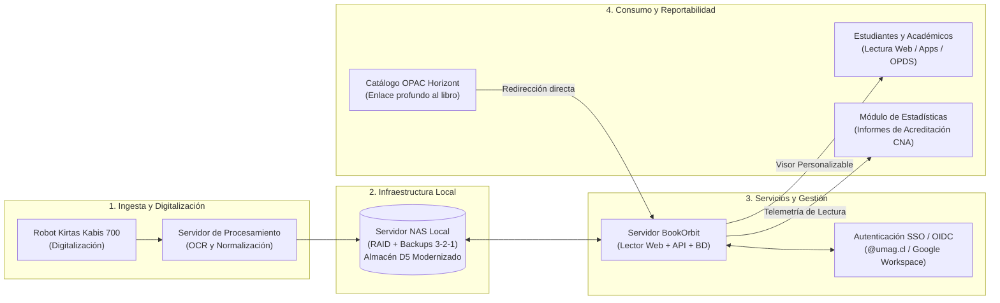
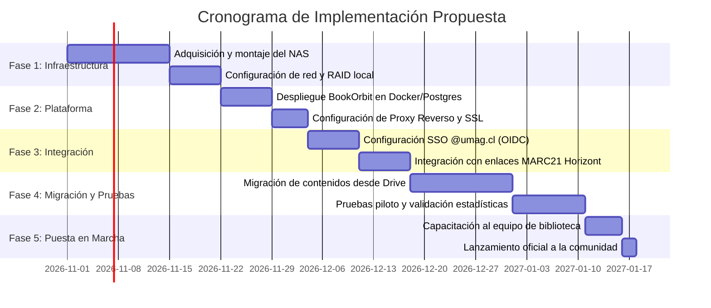

Actualmente, los libros y documentos escaneados mediante el robot de digitalización institucional (*Kirtas Kabis 700*) se almacenan de manera desestructurada en carpetas de **Google Drive** (`D5`), facilitando su acceso mediante enlaces estáticos en el catálogo OPAC/Horizont (`D1`). No obstante, este esquema carece completamente de herramientas de telemetría y estadísticas de uso, presenta un control de acceso rudimentario, brinda una experiencia de lectura deficiente.

Para resolver esta brecha, se propone el despliegue de una infraestructura local compuesta por un servidor de almacenamiento conectado en red (**NAS - Network Attached Storage**) y la implementación de la plataforma de biblioteca digital **BookOrbit**. Esta combinación permitirá centralizar y respaldar localmente la colección digital, ofrecer a los estudiantes y docentes una interfaz de lectura interactiva y personalizable, restringir el acceso mediante autenticación federada con correos institucionales (`@umag.cl`), y generar estadísticas granulares de consumo bibliográfico imprescindibles para la toma de decisiones y los procesos de **Acreditación Curricular**.

## 2. Diagnóstico del Problema y Justificación

### 2.1 Situación Actual (Almacén `D5`: Google Drive)
En el flujo operativo de la biblioteca, el procesamiento de bibliografía digital (Subproceso 1.5) contempla el escaneo automático de obras correspondientes a:
1. Bibliografía básica y complementaria para estudiantes en situación de discapacidad.
2. Bibliografía obligatoria y de alta demanda de las distintas carreras de la universidad.
3. Tesis de pregrado y postgrado, mapas y archivos patrimoniales digitalizados.

Dichos archivos en formato PDF son subidos a carpetas compartidas en Google Drive, cuyo enlace es indexado manualmente en el campo 856 (Localización y acceso electrónicos) del formato MARC21 en el software de biblioteca Horizont.

```
+------------------+         Escaneo         +----------------------+
|  Ejemplar Físico | --------------------->  | Robot Kirtas Kabis   |
+------------------+                         +----------------------+
                                                        |
                                                        | Genera PDFs
                                                        v
+------------------+      Enlace Web         +----------------------+
| Catálogo Horizont| <...................... |     Google Drive     |
|   (MARC21/D1)    |                         |         (D5)         |
+------------------+                         +----------------------+
                                                        |
                                                        | Apertura directa
                                                        v
                                             +----------------------+
                                             |  Estudiante / Alumno |
                                             |  (Sin estadísticas) |
                                             +----------------------+
```

### 2.2 Problemáticas Identificadas
1. **Ausencia Absoluta de Estadísticas de Uso:**  
   Google Drive no entrega métricas sobre lecturas efectivas: no es posible saber cuántas veces se abrió un libro, cuánto tiempo permaneció abierto, qué capítulos se leyeron, ni qué usuarios o carreras interactúan con la bibliografía.
2. **Impacto Crítico en la Acreditación Universitaria (Macroproceso 6.0):**  
   Las comisiones evaluadoras y directores de carrera solicitan recurrentemente reportes de uso de la bibliografía declarada en los programas académicos (de hasta 5 años hacia atrás). Al estar en Drive, la biblioteca no puede demostrar el impacto ni la frecuencia de uso de los textos digitales, generando vacíos de información o reportes incompletos.
3. **Experiencia de Lectura Limitada (UI/UX Pobre):**  
   El visor nativo de Google Drive solo permite visualizar páginas en cascada o descargar el archivo completo. No ofrece herramientas pedagógicas como marcadores sincronizados, notas al margen, cambio de tipografía/interlineado, temas de alto contraste o lectura nocturna.
4. **Vulnerabilidad en la Seguridad y Derechos de Autor:**  
   Aunque el acceso a las carpetas se restrinja a cuentas de la universidad, los enlaces compartidos y la facilidad de descarga directa exponen los archivos a redistribución masiva fuera del ámbito académico, acentuando los riesgos asociados a derechos de propiedad intelectual.
5. **Riesgos de Capacidad y Soberanía Tecnológica:**  
   Google Workspace for Education modificó sus políticas de almacenamiento, eliminando las cuentas ilimitadas y asignando cuotas institucionales compartidas. Los escaneos en alta fidelidad y material patrimonial consumen volúmenes significativos de almacenamiento, lo que hace inviable a largo plazo depender de un almacenamiento en la nube no especializado.


## 3. Descripción de la Solución Propuesta

La solución contempla el reemplazo del almacén `D5` (Google Drive) por un ecosistema tecnológico institucional local integrado por dos componentes principales:
1. **Servidor de Almacenamiento en Red (NAS):** Capa física y lógica de almacenamiento masivo y seguro.
2. **Plataforma BookOrbit:** Servidor web de catálogo digital, lector interactivo y motor analítico.



### 3.1 Servidor de Almacenamiento en Red (NAS)
El servidor NAS se ubicará en la sala técnica / centro de datos de la biblioteca o de la Dirección de Servicios de Informática:
* **Almacenamiento Local y Escalable:** Configuración en arreglo de discos redundantes (RAID 5 o RAID 6) que asegura tolerancia a fallos mecánicos y alta tasa de transferencia de datos.
* **Organización Jerárquica Estandarizada:** Directorios organizados por facultad, carrera, código de asignatura y tipo de documento (Bibliografía Básica, Complementaria, Tesis, Revistas, Archivos Históricos).
* **Flujo de Ingesta Automatizado:** Conexión de red de alta velocidad (1 Gbps / 10 Gbps) con la estación del escáner Kabis 700 para volcar los documentos procesados directamente a carpetas de entrada supervisadas.
* **Políticas de Respaldo Continuo:** Estrategia de respaldo 3-2-1 con copias de seguridad automáticas locales y réplicas programadas a almacenamiento frío fuera de línea.

### 3.2 Plataforma BookOrbit
BookOrbit es un sistema autohospedado moderno y de código abierto para la gestión integral de bibliotecas digitales y lectura de documentos (PDF, EPUB, etc.):
* **Despliegue Contenedorizado:** Instalación mediante Docker y Docker Compose junto a una base de datos relacional (PostgreSQL), facilitando su mantenimiento, aislamiento y portabilidad.
* **Indexación y Lectura Directa:** Monta las carpetas del NAS en modo lectura para catalogar automáticamente los volúmenes, extrayendo metadatos, tablas de contenidos e imágenes de portada.
* **Compatibilidad Multiplataforma:** Visor web HTML5 compatible con cualquier navegador moderno (escritorio, portátiles, tablets, teléfonos móviles) y soporte de protocolo OPDS para lectores electrónicos dedicados.

---

## 4. Características Clave y Beneficios Diferenciales

### 4.1 Motor de Estadísticas y Analítica en Tiempo Real
BookOrbit resuelve la mayor deficiencia del esquema actual al incorporar un sistema de telemetría de uso que registra:
* **Métricas de Consumo General:** Número total de sesiones, páginas leídas, libros abiertos y tiempo promedio de permanencia por lectura.
* **Métricas por Título y Colección:** Ranking de títulos más leídos, porcentaje de avance en los textos y recurrencia de consulta de la bibliografía básica vs. complementaria.
* **Métricas Segmentadas por Perfil y Carrera:** Vinculación de los eventos de lectura con el estamento del usuario y su programa académico.
* **Automatización para Acreditación (Macroproceso 6.0):** Generación de reportes inmediatos y exportables (CSV / Excel / PDF) cuando un Jefe de Carrera o la Dirección de Aseguramiento de la Calidad solicite evidencias del uso de recursos digitales en los últimos períodos académicos.

### 4.2 Opciones de Personalización y Experiencia del Estudiante
A diferencia del visor plano de Google Drive, BookOrbit proporciona un entorno de lectura enfocado en el aprendizaje y la comodidad visual:
* **Adaptabilidad Visual:** Modos de lectura configurables (claro, sepia, oscuro y alto contraste), ajuste dinámico de zoom, márgenes y tipografías (incluyendo fuentes accesibles como OpenDyslexic).
* **Herramientas de Estudio Interactivas:** Inserción de marcadores de página personalizados, subrayado de texto con resaltadores por colores y anotaciones personales almacenadas en la cuenta del usuario.
* **Estanterías Virtuales y Organización:** Capacidad de crear listas de lectura personalizadas, clasificar libros por asignaturas del semestre y retomar la lectura exactamente en la página donde se interrumpió en cualquier dispositivo.
* **Búsqueda Full-Text:** Búsqueda rápida por palabras clave en el cuerpo del texto para aquellos documentos digitalizados que cuenten con capa OCR generada por el robot Kabis.

### 4.3 Integración con Correos Institucionales (SSO / OIDC)
El sistema garantizará el acceso seguro y exclusivo para la comunidad universitaria mediante:
* **Autenticación Unificada (Single Sign-On):** Integración nativa con el proveedor de identidad institucional (Google Workspace / Microsoft 365 / Keycloak) vía protocolo OAuth 2.0 / OpenID Connect (OIDC).
* **Restricción por Dominio `@umag.cl`:** Únicamente alumnos regulares, docentes y funcionarios con cuenta de correo institucional activa podrán iniciar sesión.
* **Aprovisionamiento Automático de Cuentas (Just-in-Time):** El usuario no requiere registrarse previamente; al iniciar sesión por primera vez con su correo institucional, se crea su perfil de estudiante de forma transparente.
* **Mitigación de Riesgos Legales:** Al evitar enlaces públicos abiertos de Drive y controlar la sesión mediante credenciales institucionales verificadas, la biblioteca respalda el uso estrictamente educativo y de investigación conforme a la legislación de propiedad intelectual.

---

## 5. Integración con el Sistema de Información Existente (DSIA)

La implementación se articula armónicamente con los macroprocesos ya modelados en el sistema de bibliotecas:

```
+--------------------------------------------------------------------------------------------------+
|                                    MATRIZ DE INTEGRACIÓN DSIA                                    |
+--------------------------------------------------------------------------------------------------+
| Macroproceso DSIA           | Impacto Actual (Google Drive)       | Impacto con BookOrbit + NAS  |
+-----------------------------+-------------------------------------+------------------------------+
| 1.0 Catalogación y Procesos | Sube manual a Drive D5. Genera URL  | Digitalizador envía al NAS.  |
| Técnicos (Subproceso 1.5)   | genérica. Desacople total.          | BookOrbit genera URL segura  |
|                             |                                     | indexable en MARC21 Horizont.|
+-----------------------------+-------------------------------------+------------------------------+
| 2.0 Circulación y Servicios | Usuario abre enlace en OPAC; Drive  | Usuario hace clic en Horizont|
| al Usuario                  | no sabe quién es ni si lee el libro.| entra por SSO @umag.cl y lee |
|                             |                                     | con herramientas avanzadas.  |
+-----------------------------+-------------------------------------+------------------------------+
| 4.0 Control de Inventario   | Archivos dispersos en Drive sin     | Inventario digital auditable |
| Digital                     | control de versiones ni integridad. | en NAS con integridad hash.  |
+-----------------------------+-------------------------------------+------------------------------+
| 6.0 Acreditación y          | Cero métricas. Imposible reportar   | Exportación automatizada de  |
| Reportabilidad Curricular   | uso de libros digitales.            | analítica de lectura por     |
|                             |                                     | carrera y asignatura.        |
+--------------------------------------------------------------------------------------------------+
```

1. **Vínculo con el Software Horizont (`D1`):**  
   En la catalogación MARC21 de recursos electrónicos, el campo 856 `$u` apuntará directamente a la URI del título en el servidor BookOrbit (`https://biblioteca-digital.umag.cl/book/{id}`).
2. **Reemplazo del Almacén de Datos `D5`:**  
   En el Diccionario de Datos y DFDs del proyecto, `D5` pasa de denominarse *“Google Drive Institucional”* a **“Repositorio Digital Local BookOrbit / NAS”**.

---

## 6. Cuadro Comparativo: Situación Actual vs. Solución Propuesta

| Dimensión de Análisis | Situación Actual (Google Drive `D5`) | Propuesta (BookOrbit + Servidor NAS) |
| :--- | :--- | :--- |
| **Almacenamiento y Soberanía** | Nube pública de terceros sujeta a cuotas variables de almacenamiento institucional. | Servidor NAS local dedicado en centro de datos propio, con RAID y capacidad ampliable. |
| **Analítica y Estadísticas** | Inexistentes. Solo se conocen visitas a la carpeta si se audita el log de Google Workspace. | Panel integral de estadísticas: horas de lectura, páginas leídas, libros más vistos por carrera. |
| **Acreditación Curricular** | Proceso ciego: no hay forma de demostrar el uso de bibliografía digital básica a la CNA. | Reportes inmediatos parametrizados por carrera, asignatura y año académico. |
| **Experiencia de Lectura** | Lector genérico de PDFs en navegador. No guarda posición de lectura ni notas. | Lector moderno interactivo, modo oscuro/sepia, fuentes personalizadas, marcadores y notas. |
| **Autenticación y Seguridad** | Permisos basados en compartir enlaces por correo. Fácil copia externa no controlada. | Single Sign-On (OIDC) con correo institucional `@umag.cl` y lectura en streaming protegido. |
| **Sincronización Multidispositivo**| Descarga manual del archivo en cada dispositivo. | Marcadores y progreso sincronizados automáticamente entre PC, tablets y dispositivos móviles. |
| **Costo Operativo Recurrente** | Riesgo de cobro por sobreconsumo de almacenamiento en Google Workspace. | Software de código abierto (sin costos de licenciamiento por usuario) sobre hardware propio. |

---

## 7. Plan de Implementación y Fases



### Detalle de las Etapas:
1. **Fase 1: Preparación de Infraestructura y Almacenamiento (Semanas 1-3):**
   * Puesta en marcha de la unidad NAS con discos en arreglo RAID.
   * Creación de la estructura de volúmenes y permisos para la estación de digitalización (Robot Kabis 700).
2. **Fase 2: Despliegue de BookOrbit (Semanas 3-4):**
   * Configuración de contenedor Docker con BookOrbit y PostgreSQL.
   * Montaje de las carpetas del NAS como volúmenes de medios.
   * Implementación de proxy inverso Nginx con certificado SSL institucional (`https://`).
3. **Fase 3: Integración de Autenticación y Catálogo (Semanas 5-6):**
   * Configuración de credenciales de cliente OAuth2/OIDC en la consola de Google Cloud institucional para autorizar el dominio `@umag.cl`.
   * Vinculación del patrón de URLs canónicas con los registros de Horizont.
4. **Fase 4: Migración de Archivos y Auditoría (Semanas 7-8):**
   * Transferencia masiva de los libros digitales alojados en Google Drive al NAS.
   * Validación de metadatos, tablas de contenidos e indexación en BookOrbit.
5. **Fase 5: Marcha Blanca y Capacitación (Semanas 9-10):**
   * Capacitación al personal de Procesos Técnicos, Circulación y Acreditación.
   * Difusión a las direcciones de carrera y comunidad estudiantil.

---

## 8. Conclusión

La sustitución del repositorio informal en Google Drive por una arquitectura local basada en **BookOrbit y un servidor NAS** constituye una mejora estratégica de alto impacto para la Universidad de Magallanes. 

Esta solución no solo moderniza el almacenamiento físico y asegura la soberanía sobre el patrimonio bibliográfico digitalizado, sino que dignifica la experiencia del estudiante mediante una plataforma de lectura de estándar internacional y entrega, por primera vez en la historia de la biblioteca, **visibilidad y analítica cuantitativa en tiempo real** sobre el uso efectivo de la bibliografía académica. Con ello, el Sistema de Bibliotecas se posiciona como un actor clave y automatizado en los procesos de acreditación y calidad universitaria.
